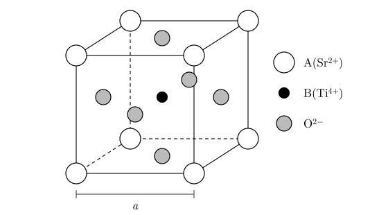

# ペロブスカイト型構造と酸素の欠損(大問I型 無機・結晶 / 想定20分 / 標準)

狙い: 大問 I の定番(結晶格子の計量+無機の知識+量的関係)を、過去 20 年で未出題のペロブスカイト型構造で組んだ。
その場で与える知識は「2 種類の陽イオンが同時に陰イオンと接する条件」から定義する指標 $t$(名称は伏せた。コードブックでは L2 の軽いもの、概念定義)と、酸素が欠損した不定比化合物(2011 I(a) の Fe$_{1-x}$O と同型)。
限界半径比(2014, 2026)の考え方を、陽イオンが 2 種類ある場合に拡張させるのが核。

## 問題

次の文章を読み,**問1**〜**問6**に答えよ。解答はそれぞれ所定の解答欄に記入せよ。ただし,アボガドロ定数は $6.0 \times 10^{23}\,/\mathrm{mol}$,原子量は $\mathrm{H} = 1.0$,$\mathrm{O} = 16$,$\mathrm{Ti} = 48$,$\mathrm{Sr} = 88$ とし,$\sqrt{2} = 1.41$,$(0.390)^3 = 0.0593$ とする。

チタン酸ストロンチウム $\mathrm{SrTiO_3}$ やチタン酸バリウム $\mathrm{BaTiO_3}$ は,コンデンサーなどの電子部品の材料として用いられている。ストロンチウムとバリウムは,いずれも周期表の [ あ ] 族に属する元素で,原子は [ い ] 個の価電子をもつ。これらの元素の化合物は炎色反応を示し,ストロンチウムは [ う ] 色,バリウムは黄緑色を呈する。一方,チタンは周期表の第 4 周期の 4 族に属する [ え ] 元素である。$\mathrm{SrTiO_3}$ は,炭酸ストロンチウム $\mathrm{SrCO_3}$ と酸化チタン(IV) $\mathrm{TiO_2}$ の粉末をよく混合して高温で加熱すると,<u>気体の発生をともなって生成する</u>。

**図1**に $\mathrm{SrTiO_3}$ の結晶の単位格子を示す。この構造はペロブスカイト型構造とよばれ,組成式 $\mathrm{ABO_3}$(A,B は陽イオン)で表される多くの化合物がこの構造をとる。単位格子は一辺の長さ $a$ の立方体で,頂点に陽イオン A,中心に陽イオン B,各面の中心に酸化物イオン $\mathrm{O^{2-}}$ が位置している。1 個の B に最も近い $\mathrm{O^{2-}}$ は [ お ] 個あり,1 個の A に最も近い $\mathrm{O^{2-}}$ は [ か ] 個ある。

ペロブスカイト型構造のとりやすさは,イオンをそれぞれ固有の半径をもつ球とみなして考えることができる。A,B,$\mathrm{O^{2-}}$ の半径をそれぞれ $r_{\mathrm{A}}$,$r_{\mathrm{B}}$,$r_{\mathrm{O}}$ とする。B と $\mathrm{O^{2-}}$ が接しているとき $a = 2(r_{\mathrm{B}} + r_{\mathrm{O}})$ であり,A と $\mathrm{O^{2-}}$ が接しているとき $a =$ [ き ] $\times (r_{\mathrm{A}} + r_{\mathrm{O}})$ である。したがって,A と $\mathrm{O^{2-}}$,B と $\mathrm{O^{2-}}$ がともに接するのは,次式で定義される $t$ の値が 1 のときである。

$$t = \frac{r_{\mathrm{A}} + r_{\mathrm{O}}}{\sqrt{2}\,(r_{\mathrm{B}} + r_{\mathrm{O}})}$$

$t$ の値が 1 に近い化合物ほど,**図1**のひずみのない構造をとりやすい。**表1**に,関連するイオンの半径を示す。

**表1**

| イオン | $\mathrm{Ca^{2+}}$ | $\mathrm{Sr^{2+}}$ | $\mathrm{Ba^{2+}}$ | $\mathrm{Ti^{4+}}$ | $\mathrm{O^{2-}}$ |
|---|---|---|---|---|---|
| 半径〔nm〕 | 0.134 | 0.144 | 0.161 | 0.061 | 0.140 |

$\mathrm{SrTiO_3}$ は無色で電気を通さないが,水素中で高温に加熱すると,**図1**の構造を保ったまま $\mathrm{O^{2-}}$ の一部が失われ,組成式 $\mathrm{SrTiO}_{3-x}$ で表される化合物になる。このとき,失われた酸素は水素と反応して水になり,結晶全体が電気的に中性に保たれるように $\mathrm{Ti^{4+}}$ の一部が $\mathrm{Ti^{3+}}$ に変化する。こうして得られた結晶は電気を通す。

**問1** [ あ ] 〜 [ か ] に入る適切な数字または語句をそれぞれ答えよ。

**問2** 下線部について,この反応の反応式を記せ。

**問3** 次の(i),(ii)に答えよ。

(i) [ き ] に入る適切な数値を答えよ。根号を含んだままでよい。

(ii) **表1**の値を用いて,$\mathrm{CaTiO_3}$,$\mathrm{SrTiO_3}$,$\mathrm{BaTiO_3}$ のそれぞれについて $t$ の値を求め,小数第 2 位まで答えよ。

**問4** イオンを変形しない球とみなし,$\mathrm{O^{2-}}$ は陽イオン A,B の少なくとも一方と接しているとする。$t$ の値が 1 より大きい化合物が**図1**の構造をとるとき,イオンどうしの接し方として最も適切なものを,次の①〜③から一つ選び,番号で答えよ。また,$t$ の値が 1 より小さい化合物についても,同様に一つ選び,番号で答えよ。

①　A と $\mathrm{O^{2-}}$ は接しているが,B と $\mathrm{O^{2-}}$ の間にはすき間がある。

②　B と $\mathrm{O^{2-}}$ は接しているが,A と $\mathrm{O^{2-}}$ の間にはすき間がある。

③　A と $\mathrm{O^{2-}}$,B と $\mathrm{O^{2-}}$ のどちらも接している。

**問5** $\mathrm{SrTiO_3}$ の単位格子の一辺の長さは $a = 0.390\,\mathrm{nm}$ である。次の(i),(ii)に答えよ。

(i) $\mathrm{SrTiO_3}$ の結晶の密度〔$\mathrm{g/cm^3}$〕を有効数字 2 けたで答えよ。

(ii) 結晶中で最も近い $\mathrm{Sr^{2+}}$ と $\mathrm{O^{2-}}$ の中心間距離〔nm〕を有効数字 3 けたで答えよ。

**問6** $\mathrm{SrTiO_3}$ の結晶 $18.4\,\mathrm{g}$ を水素中で加熱したところ,結晶の質量が $0.16\,\mathrm{g}$ 減少し,$\mathrm{SrTiO}_{3-x}$ が得られた。次の(i)〜(iii)に答えよ。

(i) $x$ の値を有効数字 2 けたで答えよ。

(ii) 得られた結晶に含まれるチタンのうち,$\mathrm{Ti^{3+}}$ として存在するものの割合〔%〕を有効数字 2 けたで答えよ。

(iii) この加熱で生成した水の質量〔g〕を有効数字 2 けたで答えよ。

## 解答

**問1** あ: 2　い: 2　う: 紅(深赤)　え: 遷移　お: 6　か: 12

**問2** $\mathrm{SrCO_3 + TiO_2 \longrightarrow SrTiO_3 + CO_2}$

**問3** (i) $\sqrt{2}$　(ii) $\mathrm{CaTiO_3}$: 0.97　$\mathrm{SrTiO_3}$: 1.00　$\mathrm{BaTiO_3}$: 1.06

**問4** $t > 1$ のとき: ①　$t < 1$ のとき: ②

**問5** (i) $5.2\,\mathrm{g/cm^3}$　(ii) $0.277\,\mathrm{nm}$

**問6** (i) 0.10　(ii) 20 %　(iii) $0.18\,\mathrm{g}$

## 解説(新しい指標 t をどこでどう使うか)

**問1** B(中心)から見て最も近い $\mathrm{O^{2-}}$ は 6 つの面の中心(距離 $a/2$)。A(頂点)から見て最も近い $\mathrm{O^{2-}}$ は,その頂点を共有する面の中心で,距離は面の対角線の半分 $a/\sqrt{2}$。1 つの頂点は 8 個の立方体に共有され,各立方体でその頂点を含む面は 3 枚,各面は 2 個の立方体に共有されるから $8 \times 3 \div 2 = 12$ 個。面心立方格子の最近接原子数 12 と同じ数え方である。

単位格子内の数は A: $\tfrac{1}{8} \times 8 = 1$,B: 1,O: $\tfrac{1}{2} \times 6 = 3$ で,組成 $\mathrm{ABO_3}$ と合う。

**問2** 炭酸塩が酸性酸化物に近いはたらきをする $\mathrm{TiO_2}$ と反応して $\mathrm{CO_2}$ を放出する。Sr は $+2$,Ti は $+4$ のままで,酸化還元反応ではない。

**問3** (i) A と $\mathrm{O^{2-}}$ の中心間距離は $a/\sqrt{2}$。接しているとき $a/\sqrt{2} = r_{\mathrm{A}} + r_{\mathrm{O}}$ より $a = \sqrt{2}(r_{\mathrm{A}} + r_{\mathrm{O}})$。これと $a = 2(r_{\mathrm{B}} + r_{\mathrm{O}})$ が同時に成り立つ条件が $t = 1$。

(ii) 分母は共通で $1.41 \times (0.061 + 0.140) = 0.2834$。

- $\mathrm{CaTiO_3}$: $0.274 / 0.2834 = 0.967 \to 0.97$
- $\mathrm{SrTiO_3}$: $0.284 / 0.2834 = 1.002 \to 1.00$
- $\mathrm{BaTiO_3}$: $0.301 / 0.2834 = 1.062 \to 1.06$

**問4** ここが「与えられた定義を使う」設問。$t > 1$ は $\sqrt{2}(r_{\mathrm{A}} + r_{\mathrm{O}}) > 2(r_{\mathrm{B}} + r_{\mathrm{O}})$,つまり A–O の接触が要求する $a$ のほうが B–O の接触が要求する $a$ より大きい。球は重なれないので $a$ は大きいほうで決まり,A と $\mathrm{O^{2-}}$ が接し,B のまわりにはすき間ができる(①)。$t < 1$ は逆で,B と $\mathrm{O^{2-}}$ が接し,A のまわりにすき間ができる(②)。

実際の $\mathrm{BaTiO_3}$($t = 1.06$)では,室温で $\mathrm{Ti^{4+}}$ が単位格子の中心からわずかにずれており,これが大きな誘電率の原因になっている。$\mathrm{CaTiO_3}$($t = 0.97$)では,$\mathrm{O^{2-}}$ の八面体が傾いて A のまわりのすき間を埋め,単位格子は立方体からひずむ。

**問5** (i) 単位格子に $\mathrm{SrTiO_3}$ が 1 個分。式量は $88 + 48 + 16 \times 3 = 184$。$a^3 = 0.0593\,\mathrm{nm^3} = 5.93 \times 10^{-23}\,\mathrm{cm^3}$ より

$$\frac{184}{6.0 \times 10^{23} \times 5.93 \times 10^{-23}} = \frac{184}{35.6} = 5.17 \fallingdotseq 5.2\,\mathrm{g/cm^3}$$

(ii) $a/\sqrt{2} = 0.390 / 1.41 = 0.2766 \fallingdotseq 0.277\,\mathrm{nm}$。**表1**の半径の和 $0.284\,\mathrm{nm}$ より少し短い。実際のイオンは変形しない球ではないので,このくらいのずれは生じる。

**問6** (i) $\mathrm{SrTiO_3}$ $18.4\,\mathrm{g}$ は $0.100\,\mathrm{mol}$。減少した $0.16\,\mathrm{g}$ は失われた O 原子の質量で $0.010\,\mathrm{mol}$。$\mathrm{SrTiO_3}$ $1\,\mathrm{mol}$ あたり $0.10\,\mathrm{mol}$ だから $x = 0.10$。

(ii) $\mathrm{Ti^{3+}}$ の割合を $y$ とすると,電荷のつり合いから

$$(+2) + (+3)y + (+4)(1 - y) + (-2)(3 - x) = 0 \quad\Longrightarrow\quad y = 2x = 0.20$$

$\mathrm{O^{2-}}$ が 1 個抜けるごとに負電荷が 2 減るので,$\mathrm{Ti^{4+}}$ 2 個が $\mathrm{Ti^{3+}}$ になる。20 %。

(iii) O 原子 $0.010\,\mathrm{mol}$ が $\mathrm{H_2O}$ $0.010\,\mathrm{mol}$ になるので $0.18\,\mathrm{g}$。

**差がつく点**: 問1 の [ か ](12)と問4。問4 は「$a$ は大きいほうの要求で決まる」と言い換えられるかどうか。

## 出典・検証

- $t$ はゴルトシュミットの許容因子(tolerance factor)。定義と,$\mathrm{SrTiO_3} \approx 1.00$,$\mathrm{BaTiO_3} \approx 1.06$,$\mathrm{CaTiO_3} \approx 0.97$ という値は文献値と一致する(出典により $\mathrm{CaTiO_3}$ は 0.95〜0.97)。
  - https://en.wikipedia.org/wiki/Goldschmidt_tolerance_factor
  - https://arxiv.org/pdf/1702.07690 ($\mathrm{SrTiO_3}$ の $t = 1.00$)
  - https://arxiv.org/pdf/0803.1729 ($\mathrm{BaTiO_3}$ 1.07,$\mathrm{CaTiO_3}$ 0.97)
- イオン半径はシャノンの値(Sr$^{2+}$ 144 pm,Ba$^{2+}$ 161 pm,Ca$^{2+}$ 134 pm はいずれも 12 配位,Ti$^{4+}$ 61 pm,O$^{2-}$ 140 pm)を丸めたもの。
- $\mathrm{SrTiO_3}$ の格子定数の文献値は 0.3905 nm,密度は約 5.1 g/cm³。本問の 5.2 g/cm³ は原子量とアボガドロ定数を丸めた結果で,整合する。
- 検算: 単位格子内の原子数 1 : 1 : 3。問6 の電荷 $2 + 3(0.2) + 4(0.8) - 2(2.9) = 0$。
- 未検証: 還元した $\mathrm{SrTiO_3}$ が導電性を示すことは広く知られた事実として書いたが,今回は典拠 URL を確認していない。
