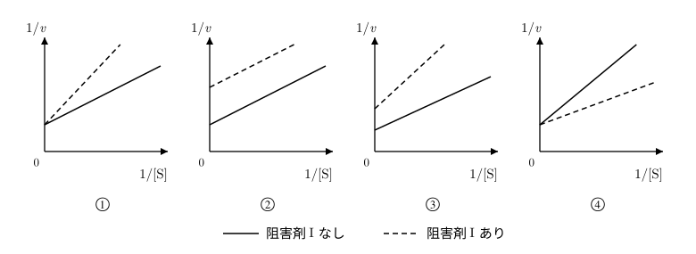

# 酵素反応の速度式と阻害剤(型A 理論 / モデルの提示 → 立式 → 直線化 → 数値 / 想定25分 / やや難)

狙い: `analysis/trend.md` の理論型(2011 II 吸着,2014 II 前駆平衡,2024 II ガス吸収,2026 II 吸着+解離)と同じ骨格。
「仮定を与える → 文字式を空欄で導出 → 逆数をとって直線にする → 2 点のデータから定数を決める → 条件を足して式がどう変わるか」。
その場で与えるのは定常状態の仮定(コードブック L2,モデルの提示)と,阻害剤の結合平衡。名称(ミカエリス・メンテン)は伏せた。
既習事項との連立は,反応速度式,平衡定数,一次反応。

## 問題

次の文章を読み,**問1**〜**問6**に答えよ。解答はそれぞれ所定の解答欄に記入せよ。ただし,$\log_e 2 = 0.693$ とする。また,物質 X のモル濃度を [X] と表す。

酵素 E は,基質 S と結合して複合体 ES をつくる。ES からは生成物 P が生じ,同時に E が再生する。これらの過程は,次の式(1),(2)で表される。

$$\mathrm{E + S} \rightleftarrows \mathrm{ES} \qquad (1)$$

$$\mathrm{ES} \longrightarrow \mathrm{E + P} \qquad (2)$$

式(1)の正反応,式(1)の逆反応,式(2)の反応の速度定数をそれぞれ $k_1$,$k_{-1}$,$k_2$ とすると,それぞれの反応の速度は $k_1[\mathrm{E}][\mathrm{S}]$,$k_{-1}[\mathrm{ES}]$,$k_2[\mathrm{ES}]$ と表される。

S の濃度が E の濃度に比べて十分大きいとき,反応開始直後のごく短い時間を除いて,ES が生成する速度と ES が消失する速度はつり合い,[ES] は一定とみなせる。この状態では,ES が生成する速度 [ ア ] と,ES が消失する速度 [ イ ] が等しい。ここで,

$$K_{\mathrm{m}} = \frac{k_{-1} + k_2}{k_1} \qquad (3)$$

とおき,S と結合していない酵素と ES を合わせた酵素の全濃度を $[\mathrm{E}]_0 = [\mathrm{E}] + [\mathrm{ES}]$ とすると,[ES] は $[\mathrm{E}]_0$,[S],$K_{\mathrm{m}}$ を用いて $[\mathrm{ES}] =$ [ ウ ] と表される。したがって,P が生成する速度 $v$ は

$$v = k_2[\mathrm{ES}] = \frac{V[\mathrm{S}]}{K_{\mathrm{m}} + [\mathrm{S}]} \qquad (4)$$

となる。ここで $V =$ [ エ ] である。式(4)より,[S] が $K_{\mathrm{m}}$ に比べて十分大きいとき,$v$ は [S] によらない一定値 [ オ ] に近づく。逆に,[S] が $K_{\mathrm{m}}$ に比べて十分小さいとき,$v$ は [S] に比例し,$v =$ [ カ ] $\times [\mathrm{S}]$ とみなせる。また,$[\mathrm{S}] = K_{\mathrm{m}}$ のとき,$v$ は $V$ の [ キ ] 倍である。

式(4)の両辺の逆数をとると

$$\frac{1}{v} = \frac{K_{\mathrm{m}}}{V} \cdot \frac{1}{[\mathrm{S}]} + \frac{1}{V} \qquad (5)$$

となるので,$\dfrac{1}{[\mathrm{S}]}$ を横軸に,$\dfrac{1}{v}$ を縦軸にとってグラフを描くと直線が得られ,その傾きと縦軸の切片から $K_{\mathrm{m}}$ と $V$ を求めることができる。

**実験1** 酵素の全濃度を $[\mathrm{E}]_0 = 1.0 \times 10^{-8}\,\mathrm{mol/L}$ とし,一定温度で,S の濃度を変えて反応開始直後の $v$ を測定したところ,**表1**の結果が得られた。

**表1**

| [S]〔mol/L〕 | $1.0 \times 10^{-3}$ | $4.0 \times 10^{-3}$ |
|---|---|---|
| $v$〔mol/(L·s)〕 | $2.0 \times 10^{-6}$ | $4.0 \times 10^{-6}$ |

**実験2** 物質 I は,S と結合していない酵素 E とだけ結合して複合体 EI をつくり,EI は S と結合できない。E と I の結合は式(6)で表され,つねに平衡が成り立っているものとする。その平衡定数を式(7)の $K_{\mathrm{I}}$ とする。

$$\mathrm{EI} \rightleftarrows \mathrm{E + I} \qquad (6)$$

$$K_{\mathrm{I}} = \frac{[\mathrm{E}][\mathrm{I}]}{[\mathrm{EI}]} \qquad (7)$$

**実験1**と同じ条件の溶液に,I を濃度が $3.0 \times 10^{-4}\,\mathrm{mol/L}$ になるように加えたところ,$[\mathrm{S}] = 1.0 \times 10^{-3}\,\mathrm{mol/L}$ のときの $v$ は $1.2 \times 10^{-6}\,\mathrm{mol/(L \cdot s)}$ であった。ただし,I の濃度は E の濃度に比べて十分大きく,[I] は加えた濃度に等しいとみなせる。

**問1** [ ア ] 〜 [ キ ] に入る適切な式または数値をそれぞれ答えよ。

**問2** **実験1**の結果から,$V$〔mol/(L·s)〕と $K_{\mathrm{m}}$〔mol/L〕の値をそれぞれ有効数字 2 けたで答えよ。

**問3** $k_2$ の値を有効数字 2 けたで,単位とともに答えよ。

**問4** **実験1**と同じ酵素濃度と温度で,S の初濃度を $2.0 \times 10^{-5}\,\mathrm{mol/L}$ として反応を開始した。[S] が $1.0 \times 10^{-5}\,\mathrm{mol/L}$ になるまでの時間〔s〕を有効数字 2 けたで答えよ。ただし,S の濃度の減少速度は $v$ に等しく,一般に,ある物質の濃度 $c$ の減少速度が $kc$($k$ は定数)と表されるとき,$c$ が半分になるまでの時間は $\dfrac{\log_e 2}{k}$ である。

**問5** **実験2**について,次の(i),(ii)に答えよ。

(i) I が存在するとき,酵素の全濃度は $[\mathrm{E}]_0 = [\mathrm{E}] + [\mathrm{ES}] + [\mathrm{EI}]$ である。このとき,$v$ は式(4)の $K_{\mathrm{m}}$ を $K_{\mathrm{m}} \times$ [ ク ] に置き換えた式で表される。[ ク ] に入る適切な式を,[I] と $K_{\mathrm{I}}$ を用いて答えよ。

(ii) $K_{\mathrm{I}}$〔mol/L〕の値を有効数字 2 けたで答えよ。

**問6** 次の(i),(ii)に答えよ。

(i) I が存在しない場合と,I が一定濃度で存在する場合について,$\dfrac{1}{[\mathrm{S}]}$ と $\dfrac{1}{v}$ の関係を表すグラフとして最も適切なものを,**図1**の①〜④から一つ選び,番号で答えよ。

(ii) I が存在していても,[S] を十分大きくすれば,$v$ は I が存在しない場合と同じ値 [ オ ] に近づく。その理由を,E に対する S と I の関係に着目して,40 字以内で説明せよ。

## 解答

**問1** ア: $k_1[\mathrm{E}][\mathrm{S}]$　イ: $(k_{-1} + k_2)[\mathrm{ES}]$　ウ: $\dfrac{[\mathrm{E}]_0[\mathrm{S}]}{K_{\mathrm{m}} + [\mathrm{S}]}$　エ: $k_2[\mathrm{E}]_0$　オ: $V$(または $k_2[\mathrm{E}]_0$)　カ: $\dfrac{V}{K_{\mathrm{m}}}$　キ: $\dfrac{1}{2}$(0.5)

**問2** $V = 6.0 \times 10^{-6}\,\mathrm{mol/(L \cdot s)}$　$K_{\mathrm{m}} = 2.0 \times 10^{-3}\,\mathrm{mol/L}$

**問3** $6.0 \times 10^{2}\,/\mathrm{s}$

**問4** $2.3 \times 10^{2}\,\mathrm{s}$

**問5** (i) $1 + \dfrac{[\mathrm{I}]}{K_{\mathrm{I}}}$　(ii) $3.0 \times 10^{-4}\,\mathrm{mol/L}$

**問6** (i) ①　(ii) S と I は E を奪い合うので,S が十分多ければ E はほぼすべて S と結合するから。(39 字)

## 解説(与えられた仮定をどこでどう使うか)

**問1** ES は式(1)の正反応で生じ,式(1)の逆反応と式(2)の 2 つの経路で消える。[ES] が一定という仮定から

$$k_1[\mathrm{E}][\mathrm{S}] = (k_{-1} + k_2)[\mathrm{ES}] \quad\Longrightarrow\quad [\mathrm{E}][\mathrm{S}] = K_{\mathrm{m}}[\mathrm{ES}]$$

平衡の式と形は同じだが,$k_2$ が入っている点が違う(式(1)は平衡ではなく,ES が式(2)で抜けていく)。$[\mathrm{E}] = [\mathrm{E}]_0 - [\mathrm{ES}]$ を代入して

$$([\mathrm{E}]_0 - [\mathrm{ES}])[\mathrm{S}] = K_{\mathrm{m}}[\mathrm{ES}] \quad\Longrightarrow\quad [\mathrm{ES}] = \frac{[\mathrm{E}]_0[\mathrm{S}]}{K_{\mathrm{m}} + [\mathrm{S}]}$$

これに $k_2$ をかけて式(4),$V = k_2[\mathrm{E}]_0$。$[\mathrm{S}] \gg K_{\mathrm{m}}$ なら分母は [S] とみなせて $v = V$(すべての酵素が ES になっている状態)。$[\mathrm{S}] \ll K_{\mathrm{m}}$ なら分母は $K_{\mathrm{m}}$ とみなせて $v = (V/K_{\mathrm{m}})[\mathrm{S}]$。$[\mathrm{S}] = K_{\mathrm{m}}$ なら $v = V/2$。

**問2** 式(5)に 2 点を代入する。$1/[\mathrm{S}]$ は $1.0 \times 10^{3}$ と $2.5 \times 10^{2}\,\mathrm{L/mol}$,$1/v$ は $5.0 \times 10^{5}$ と $2.5 \times 10^{5}\,\mathrm{L \cdot s/mol}$。

$$\text{傾き}\ \frac{K_{\mathrm{m}}}{V} = \frac{(5.0 - 2.5) \times 10^{5}}{(10 - 2.5) \times 10^{2}} = \frac{1}{3} \times 10^{3}\,\mathrm{s}$$

$$\text{切片}\ \frac{1}{V} = 5.0 \times 10^{5} - \frac{1}{3} \times 10^{3} \times 1.0 \times 10^{3} = \frac{5}{3} \times 10^{5}\,\mathrm{L \cdot s/mol}$$

よって $V = 6.0 \times 10^{-6}\,\mathrm{mol/(L \cdot s)}$,$K_{\mathrm{m}} = \tfrac{1}{3} \times 10^{3} \times 6.0 \times 10^{-6} = 2.0 \times 10^{-3}\,\mathrm{mol/L}$。

検算: $[\mathrm{S}] = 1.0 \times 10^{-3}$ で $v = 6.0 \times 10^{-6} \times \tfrac{1}{3} = 2.0 \times 10^{-6}$,$[\mathrm{S}] = 4.0 \times 10^{-3}$ で $v = 6.0 \times 10^{-6} \times \tfrac{4}{6} = 4.0 \times 10^{-6}$。

**問3** $k_2 = V / [\mathrm{E}]_0 = 6.0 \times 10^{-6} / 1.0 \times 10^{-8} = 6.0 \times 10^{2}\,/\mathrm{s}$。ES 1 個が 1 秒間に 600 個の P をつくるという意味。

**問4** 初濃度 $2.0 \times 10^{-5}\,\mathrm{mol/L}$ は $K_{\mathrm{m}}$ の 1 % で,以後さらに減る。[カ] の近似が使えて,S の減少速度は $(V/K_{\mathrm{m}})[\mathrm{S}]$,つまり $k = V/K_{\mathrm{m}} = 3.0 \times 10^{-3}\,/\mathrm{s}$ の一次反応。濃度が半分になる時間は

$$\frac{0.693}{3.0 \times 10^{-3}} = 231 \fallingdotseq 2.3 \times 10^{2}\,\mathrm{s}$$

近似を使わずに式(4)を厳密に扱っても,答は 233 s で,有効数字 2 けたでは変わらない。

**問5** (i) 式(7)より $[\mathrm{EI}] = [\mathrm{E}][\mathrm{I}]/K_{\mathrm{I}}$。ES についての関係 $[\mathrm{E}][\mathrm{S}] = K_{\mathrm{m}}[\mathrm{ES}]$ は I があっても変わらない(EI は式(1),(2)に関与しない)。

$$[\mathrm{E}]_0 = [\mathrm{E}]\left(1 + \frac{[\mathrm{I}]}{K_{\mathrm{I}}}\right) + [\mathrm{ES}] = \frac{K_{\mathrm{m}}[\mathrm{ES}]}{[\mathrm{S}]}\left(1 + \frac{[\mathrm{I}]}{K_{\mathrm{I}}}\right) + [\mathrm{ES}]$$

$$v = k_2[\mathrm{ES}] = \frac{V[\mathrm{S}]}{K_{\mathrm{m}}\left(1 + \dfrac{[\mathrm{I}]}{K_{\mathrm{I}}}\right) + [\mathrm{S}]}$$

(ii) [ク] を $\alpha$ とおくと

$$1.2 \times 10^{-6} = \frac{6.0 \times 10^{-6} \times 1.0 \times 10^{-3}}{2.0 \times 10^{-3}\alpha + 1.0 \times 10^{-3}} \quad\Longrightarrow\quad \alpha = 2.0$$

$1 + [\mathrm{I}]/K_{\mathrm{I}} = 2.0$ より $K_{\mathrm{I}} = [\mathrm{I}] = 3.0 \times 10^{-4}\,\mathrm{mol/L}$。

**問6** (i) I があると,式(5)の傾きは $K_{\mathrm{m}}\alpha/V$ で大きくなり,切片 $1/V$ は変わらない。縦軸上の同じ点から出て傾きだけが大きい①。②は傾きが同じで切片だけ大きい(I が ES とだけ結合する場合に相当),③は傾きと切片がともに大きい(I が E にも ES にも結合する場合に相当)。

(ii) 切片が変わらないことの化学的な意味を問うている。

**差がつく点**: [イ](消失が 2 経路あること),問4(どの近似が使えるかを自分で判断する),問5(i)(定常状態の関係式は変わらず,酵素の収支の式だけが変わると見抜く)。

## 出典・検証

- モデルはミカエリス・メンテンの式(定常状態近似による導出),直線化はラインウィーバー・バークプロット,問5・問6 は競合阻害。いずれも生化学の標準的な内容。
  - https://en.wikipedia.org/wiki/Michaelis%E2%80%93Menten_kinetics
  - https://en.wikipedia.org/wiki/Lineweaver%E2%80%93Burk_plot
  - https://en.wikipedia.org/wiki/Competitive_inhibition
  - 今回のセッションでは上記ページを取得して照合していない(検索の利用上限に達したため)。式は自分で導出して検算した。
- 数値の検算: 問2 は 2 点とも式(4)を満たす。問5 は $K_{\mathrm{m}}\alpha = 4.0 \times 10^{-3}$ で $v = 6.0 \times 10^{-6} \times 1.0/5.0 = 1.2 \times 10^{-6}$。
- 問4 の厳密解: $K_{\mathrm{m}}\log_e 2 + ([\mathrm{S}]_0 - [\mathrm{S}]) = Vt$ より $t = (2.0 \times 10^{-3} \times 0.693 + 1.0 \times 10^{-5}) / 6.0 \times 10^{-6} = 233\,\mathrm{s}$。
- 数値($K_{\mathrm{m}}$,$k_2$)は特定の酵素の実測値ではなく,計算しやすいように設定した値。酵素として不自然でない範囲にある。
