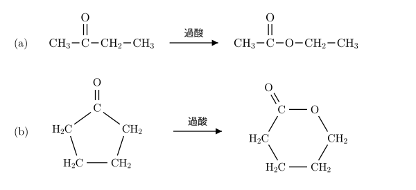
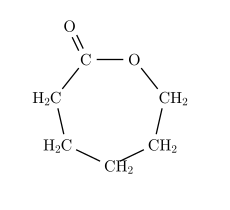

# ケトンをエステルに変える反応と構造決定(型B 有機 / 反応規則の提示 → 生成物予測 → 逆算 / 想定25分 / 標準〜やや難)

狙い: `analysis/trend.md` の有機型(2016 III 水素化分解,2019 III イミド,2024 III 付加の立体化学,2026 III アセタール交換)と同じ骨格。
未習の反応(過酸によるケトンの酸化,名称は伏せた)を,位置の規則・環の規則・立体の規則つきで与える(コードブック L2,反応の提示)。
前半は規則をそのまま使う生成物予測,後半は加水分解生成物からの逆算と量的関係。
既習事項との連立は,エステルの加水分解,ヨードホルム反応,アルコールの酸化,開環重合,PET,鏡像異性体。

## 問題

次の文章を読み,**問1**〜**問6**に答えよ。解答はそれぞれ所定の解答欄に記入せよ。構造式は**図1**の例にならって記せ。ただし,原子量は $\mathrm{H} = 1.0$,$\mathrm{C} = 12$,$\mathrm{O} = 16$ とする。

ケトンに過酢酸 $\mathrm{CH_3COOOH}$ などの過酸を作用させると,カルボニル基の炭素原子と,それに結合している 2 個の炭素原子のうちの一方との間に,酸素原子が 1 個入り,エステルが生成する。この反応を反応 X とよぶ。**図1**(a)に,2-ブタノンの反応 X を示す。反応 X には,次の規則 1 〜規則 3 がある。

規則 1　カルボニル基の炭素原子に結合している 2 個の炭素原子のうち,結合している水素原子の数が少ないほうの炭素原子と,カルボニル基の炭素原子との間に,酸素原子が入る。

規則 2　環を構成する炭素原子がカルボニル基になっているケトン(環状のケトン)からは,規則 1 にしたがって,環を構成する原子が 1 個多い環状のエステルが生成する(**図1**(b))。

規則 3　新たに酸素原子と結合する炭素原子が不斉炭素原子であるとき,その不斉炭素原子に結合している 4 個の原子または原子団の立体的な配置は,反応 X の前後で変化しない。

なお,ケトンがカルボニル基を 2 個もつ場合,十分な量の過酸を用いると,それぞれのカルボニル基で反応 X が起こる。また,以下の実験で行うエステルの加水分解では,カルボニル基の炭素原子とそれに結合している酸素原子との間の結合だけが切れるものとする。

**実験1** 分子式 $\mathrm{C_5H_{10}O}$ で表される 3 種類のケトン A,B,C のそれぞれに反応 X を行ったところ,A からはエステル D が,B からはエステル E が,C からはエステル F が得られた。D を加水分解すると,カルボン酸 G とアルコール H が得られた。E を加水分解すると,G とアルコール I が得られた。F を加水分解すると,カルボン酸 J とアルコール K が得られた。H を酸化するとケトンが得られた。I を酸化すると,アルデヒドを経て J が得られた。

**実験2** シクロヘキサノン $\mathrm{C_6H_{10}O}$(六員環の環状のケトン)に反応 X を行ったところ,化合物 L が得られた。L に触媒を加えて加熱すると,開環重合が起こり,鎖状の高分子化合物 M が得られた。M は,微生物によって分解される生分解性高分子として利用されている。

**実験3** シクロヘキサノンの,カルボニル基の隣の炭素原子に結合している水素原子 1 個をメチル基で置き換えた化合物(2-メチルシクロヘキサノン)に反応 X を行い,得られた化合物を加水分解したところ,分子内にヒドロキシ基とカルボキシ基をもつ化合物 N が得られた。

**実験4** 分子式 $\mathrm{C_6H_{10}O_2}$ で表され,カルボニル基を 2 個もつケトン P $5.70\,\mathrm{g}$ に過酸を作用させたところ,P はすべて反応し,エステル結合を 1 個もつ化合物 Q(分子式 $\mathrm{C_6H_{10}O_3}$)と,エステル結合を 2 個もつ化合物 R(分子式 $\mathrm{C_6H_{10}O_4}$)の混合物が得られた。この混合物の全量を完全に加水分解したところ,カルボン酸として酢酸のみが $4.80\,\mathrm{g}$ 得られ,そのほかに,2 価アルコール S と,ヒドロキシ基をもつケトン T が得られた。S は,テレフタル酸と縮合重合させるとポリエチレンテレフタラートを与える化合物であった。

**実験5** 分子式 $\mathrm{C_6H_{12}O}$ で表され,不斉炭素原子を 1 個もつケトン U の,一方の鏡像異性体だけからなる試料に反応 X を行い,得られたエステルを加水分解したところ,酢酸とアルコール W が得られた。

**問1** A,B,C の構造式をそれぞれ記せ。

**問2** A,B,C,H,I,K のうち,ヨードホルム反応を示すものをすべて選び,記号で答えよ。

**問3** **実験2**について,次の(i)〜(iii)に答えよ。

(i) L の構造式を記せ。

(ii) M の構造式を,繰り返し単位がわかるように記せ。

(iii) 平均分子量が $5.7 \times 10^{4}$ の M について,1 分子中に含まれるエステル結合の数の平均値を有効数字 2 けたで答えよ。ただし,M の両末端の構造は無視してよい。

**問4** N の構造式を記せ。

**問5** **実験4**について,次の(i)〜(iii)に答えよ。

(i) P の構造式を記せ。

(ii) T の構造式を記せ。

(iii) 過酸を作用させて得られた混合物に含まれる Q と R の物質量の比を,最も簡単な整数比で答えよ。

**問6** **実験5**について,次の(i),(ii)に答えよ。

(i) U の構造式を記せ。ただし,鏡像異性体は区別しなくてよい。

(ii) 得られた W は,一方の鏡像異性体だけからなるか,それとも両方の鏡像異性体の等量混合物であるか。理由とともに,60 字以内で答えよ。

## 解答

**問1**

- A: $\mathrm{CH_3\text{–}CO\text{–}CH(CH_3)\text{–}CH_3}$(3-メチル-2-ブタノン)
- B: $\mathrm{CH_3\text{–}CO\text{–}CH_2\text{–}CH_2\text{–}CH_3}$(2-ペンタノン)
- C: $\mathrm{CH_3\text{–}CH_2\text{–}CO\text{–}CH_2\text{–}CH_3}$(3-ペンタノン)

(解答欄には**図1**(a)のように $\mathrm{C\text{=}O}$ を明示して書く。)

**問2** A,B,H,K

**問3** (i) 下図(七員環の環状エステル,ε-カプロラクトン)

(ii) $\mathrm{\text{–}[\text{–}O\text{–}CH_2\text{–}CH_2\text{–}CH_2\text{–}CH_2\text{–}CH_2\text{–}CO\text{–}]_{\mathit{n}}\text{–}}$(ポリカプロラクトン)

(iii) $5.0 \times 10^{2}$

**問4** $\mathrm{CH_3\text{–}CH(OH)\text{–}CH_2\text{–}CH_2\text{–}CH_2\text{–}CH_2\text{–}COOH}$

**問5** (i) $\mathrm{CH_3\text{–}CO\text{–}CH_2\text{–}CH_2\text{–}CO\text{–}CH_3}$(2,5-ヘキサンジオン)

(ii) $\mathrm{CH_3\text{–}CO\text{–}CH_2\text{–}CH_2\text{–}OH}$

(iii) Q : R = 2 : 3

**問6** (i) $\mathrm{CH_3\text{–}CO\text{–}CH(CH_3)\text{–}CH_2\text{–}CH_3}$(3-メチル-2-ペンタノン)

(ii) 一方の鏡像異性体だけからなる。反応 X でも加水分解でも,不斉炭素原子の立体的な配置は変化しないから。(49 字)

## 解説(与えられた規則をどこでどう使うか)

**問1** $\mathrm{C_5H_{10}O}$ のケトンは 2-ペンタノン,3-ペンタノン,3-メチル-2-ブタノンの 3 種類しかない。規則 1 を当てはめる。

| ケトン | カルボニルの両隣の炭素(H の数) | 酸素が入る側 | エステル | 加水分解生成物 |
|---|---|---|---|---|
| 2-ペンタノン | $\mathrm{CH_3}$(3),$\mathrm{CH_2}$(2) | $\mathrm{CH_2}$ 側 | 酢酸プロピル | 酢酸+1-プロパノール |
| 3-ペンタノン | $\mathrm{CH_2}$(2),$\mathrm{CH_2}$(2) | どちらでも同じ | プロピオン酸エチル | プロピオン酸+エタノール |
| 3-メチル-2-ブタノン | $\mathrm{CH_3}$(3),$\mathrm{CH}$(1) | $\mathrm{CH}$ 側 | 酢酸イソプロピル | 酢酸+2-プロパノール |

D と E から共通のカルボン酸 G が出るので G は酢酸,F から出る J はプロピオン酸で,C は 3-ペンタノン,K はエタノール。H は酸化でケトンになるので第二級アルコールの 2-プロパノール,したがって A は 3-メチル-2-ブタノン。I は酸化でアルデヒドを経て J(プロピオン酸)になるので 1-プロパノール,B は 2-ペンタノン。

規則 1 を逆に(H の多い側に)使うと,2-ペンタノンから酪酸メチルが出てしまい,「D と E から同じカルボン酸」が成り立たない。

**問2** $\mathrm{CH_3CO\text{–}}$ または $\mathrm{CH_3CH(OH)\text{–}}$ の構造をもつもの。A,B はメチルケトン,H(2-プロパノール),K(エタノール)は $\mathrm{CH_3CH(OH)\text{–}}$ をもつ。C と I(1-プロパノール)は示さない。

**問3** (i) シクロヘキサノンは左右対称なので,どちら側に入っても同じ。規則 2 より六員環 → 七員環の環状エステル。

(ii) 環のエステル結合が切れてつながる。繰り返し単位 $\mathrm{\text{–}O\text{–}(CH_2)_5\text{–}CO\text{–}}$ の式量は L の分子量と同じ 114。

(iii) $5.7 \times 10^{4} / 114 = 500$。繰り返し単位 1 個につきエステル結合 1 個。

ナイロン 6 が ε-カプロラクタム(環状アミド)の開環重合でできることと対になる。

**問4** カルボニルの両隣は $\mathrm{CH(CH_3)}$(H 1 個)と $\mathrm{CH_2}$(H 2 個)。規則 1 より $\mathrm{CH(CH_3)}$ 側に酸素が入り,環状エステルの $\mathrm{\text{–}O\text{–}CH(CH_3)\text{–}}$ ができる。加水分解で $\mathrm{C(\text{=}O)\text{–}O}$ の結合が切れると,メチル基のついた炭素にヒドロキシ基が残る。

逆側に入ると $\mathrm{HO\text{–}CH_2\text{–}(CH_2)_4\text{–}CH(CH_3)\text{–}COOH}$ になる。規則 1 を正しく使えたかどうかで答が分かれる。

**問5** (i) S はエチレングリコール。R は加水分解で酢酸とエチレングリコールだけを与え,$\mathrm{C_6H_{10}O_4}$ だから,$\mathrm{CH_3COO\text{–}CH_2CH_2\text{–}OCOCH_3}$。R から,反応 X で入った酸素原子 2 個を取り除くと P は $\mathrm{CH_3CO\text{–}CH_2CH_2\text{–}COCH_3}$。規則 1 の確認: 各カルボニルの両隣は $\mathrm{CH_3}$(3)と $\mathrm{CH_2}$(2)で,$\mathrm{CH_2}$ 側に入るので合う。

(ii) Q は片方だけ反応した $\mathrm{CH_3COO\text{–}CH_2CH_2\text{–}COCH_3}$。加水分解で酢酸と $\mathrm{HO\text{–}CH_2CH_2\text{–}COCH_3}$(T)。

(iii) P は $5.70 / 114 = 0.0500\,\mathrm{mol}$。酢酸は $4.80 / 60 = 0.0800\,\mathrm{mol}$。Q を $q$,R を $r$〔mol〕とすると

$$q + r = 0.0500, \qquad q + 2r = 0.0800 \quad\Longrightarrow\quad q = 0.0200,\ r = 0.0300$$

Q : R = 2 : 3。

**問6** (i) $\mathrm{C_6H_{12}O}$ のケトンで不斉炭素原子をもつのは 3-メチル-2-ペンタノンだけ(2-ヘキサノン,3-ヘキサノン,4-メチル-2-ペンタノン,2-メチル-3-ペンタノン,3,3-ジメチル-2-ブタノンはいずれも不斉炭素原子をもたない)。酢酸が出ることとも合う: 両隣は $\mathrm{CH_3}$(3)と $\mathrm{CH}$(1)で,$\mathrm{CH}$ 側に入り酢酸 *sec*-ブチルになる。

(ii) W は 2-ブタノール。酸素と新たに結合するのが不斉炭素原子そのもので,規則 3 より配置が保たれる。加水分解で切れるのは $\mathrm{C(\text{=}O)\text{–}O}$ の結合で,不斉炭素原子と酸素の結合は切れない(問題文のただし書き)。したがって一方の鏡像異性体だけが得られる。

**差がつく点**: 問4(環で規則 1 を使い,さらに加水分解後の構造に直す),問5(iii)(片方だけ反応したものの存在を式に入れる),問6(ii)(規則 3 と加水分解のただし書きの両方に触れる)。

## 出典・検証

- 反応 X はバイヤー・ビリガー酸化。転位のしやすさは 第三級アルキル > 第二級アルキル > アリール > 第一級アルキル > メチル。本問の規則 1 は,この序列をアルキル基どうしに限って「水素の少ない炭素側」と言い換えたもの。アリール基を含む場合はこの言い換えが成り立たない(第二級アルキルのほうがフェニルより転位しやすい)ので,芳香族ケトンは出題から外した。
  - https://en.wikipedia.org/wiki/Baeyer%E2%80%93Villiger_oxidation
  - https://vrchemistry.chem.ox.ac.uk/nor/notes/migrapt.htm
- 規則 3(転位する炭素の立体配置の保持)はこの反応の標準的な性質として書いた。今回の検索では明記した典拠を確認できていない。要確認。
- シクロヘキサノン → ε-カプロラクトン → ポリカプロラクトン(生分解性)は工業的に行われている経路。今回は典拠 URL を確認していない。
- 検算: 分子量 P = 114,Q = 130,R = 146,酢酸 = 60。$0.0200 + 2 \times 0.0300 = 0.0800$。ε-カプロラクトン $\mathrm{C_6H_{10}O_2}$ = 114。
- 異性体の数え上げ: $\mathrm{C_5H_{10}O}$ のケトン 3 種,$\mathrm{C_6H_{12}O}$ のケトン 6 種(うち不斉炭素をもつもの 1 種)を列挙して確認した。
