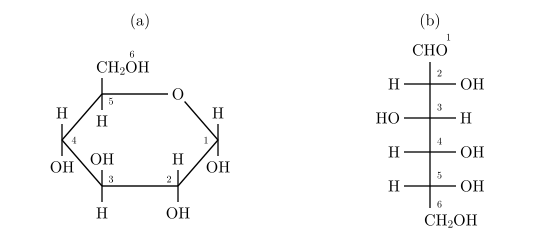
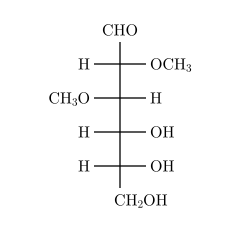

# 多糖の枝分かれを調べる二つの反応(型C 天然高分子 / 表記法+分解反応の提示 → 断片から構造を決める / 想定25分 / やや難)

狙い: 「繰り返し出る準・範囲内」である過ヨウ素酸による開裂(2022 IV,2025 IV)と投影式(2019,2020,2022 IV)を既知として読めるようにしつつ,2026 IV で軽く触れられたメチル化を本格的に使わせる。
二つの独立な方法(ギ酸の定量とメチル化分析)が同じ枝分かれの度合いを与えることを確認させ,最後に結合位置の違う多糖で「規則がはたらかない」場合を考えさせる(逆向き・拡張)。
その場で与えるのは,反応 1 の規則(L2,反応の提示),反応 2 の考え方(L2,実験手法の提示),非還元末端の定義,メチル化グルコースの名称の読み方。

## 問題

次の文章を読み,**問1**〜**問6**に答えよ。解答はそれぞれ所定の解答欄に記入せよ。ただし,原子量は $\mathrm{H} = 1.0$,$\mathrm{C} = 12$,$\mathrm{O} = 16$ とする。

デンプンは,多数の α-グルコース(**図1**(a))が縮合重合した多糖であり,直鎖状の [ ア ] と,枝分かれをもつ [ イ ] からなる。**図1**(a)のように,グルコースの炭素原子に 1 〜 6 の番号をつけ,それぞれ C1 〜 C6 とよぶ。[ ア ] では,グルコース単位の C1 に結合したヒドロキシ基と,隣のグルコース単位の C4 に結合したヒドロキシ基との間で脱水縮合が起こり,[ ウ ] 結合によってグルコース単位が連なっている。[ イ ] では,これに加えて,C1 に結合したヒドロキシ基と,別のグルコース単位の C6 に結合したヒドロキシ基との間の結合による枝分かれがある。

多糖の鎖の末端のうち,C1 に結合したヒドロキシ基が結合に使われずに残っているグルコース単位を還元末端といい,それ以外の末端を非還元末端という。枝分かれをもつ多糖 1 分子には,還元末端は 1 個しかないが,非還元末端は多数ある。以下では,多糖の分子量は十分に大きく,還元末端のグルコース単位は無視できるものとする。

グルコースは,水溶液中で環状構造と鎖状構造の平衡状態にある。鎖状構造は,**図1**(b)のような投影式で表すことができる。投影式では,炭素原子を上下に並べ,縦線と横線の交点に炭素原子があるものとし,左右にのびる結合は紙面の手前側に,上下にのびる結合は紙面の奥側に向いていることを表す。

多糖の構造を調べるために,次の反応 1 と反応 2 が用いられる。

反応 1　過ヨウ素酸イオン $\mathrm{IO_4^-}$ は,隣り合う 2 個の炭素原子にそれぞれヒドロキシ基が結合している構造に作用して,その炭素原子間の結合を切断し,それぞれをアルデヒド基に変える(式(1))。連続した 3 個の炭素原子にそれぞれヒドロキシ基が結合している構造では,2 か所の結合が切断され,中央の炭素原子はギ酸 $\mathrm{HCOOH}$ になる(式(2))。グルコース単位の間をつなぐ酸素原子や,環を構成する酸素原子は,ヒドロキシ基ではないので,この反応には関与しない。

$$\mathrm{R\text{–}CH(OH)\text{–}CH(OH)\text{–}R'} + \mathrm{IO_4^-} \longrightarrow \mathrm{R\text{–}CHO} + \mathrm{R'\text{–}CHO} + \mathrm{IO_3^-} + \mathrm{H_2O} \qquad (1)$$

$$\mathrm{R\text{–}CH(OH)\text{–}CH(OH)\text{–}CH(OH)\text{–}R'} + 2\,\mathrm{IO_4^-}$$

$$\qquad\qquad \longrightarrow \mathrm{R\text{–}CHO} + \mathrm{HCOOH} + \mathrm{R'\text{–}CHO} + 2\,\mathrm{IO_3^-} + \mathrm{H_2O} \qquad (2)$$

反応 2　多糖のすべてのヒドロキシ基 $\mathrm{\text{–}OH}$ をメトキシ基 $\mathrm{\text{–}OCH_3}$ に変えたのち,希硫酸を用いて加水分解する。このとき,グルコース単位の間の結合はすべて加水分解されるが,メトキシ基は変化しない。こうして得られる化合物を,メトキシ基の位置を用いて,たとえば C2 と C3 のヒドロキシ基だけがメトキシ基に変わったグルコースであれば「2,3-ジメチルグルコース」とよぶ。メトキシ基の位置から,もとの多糖でどのヒドロキシ基が結合に使われていたかを知ることができる。

**実験1** [ イ ] $3.24\,\mathrm{g}$ に十分な量の過ヨウ素酸ナトリウム水溶液を加えて反応 1 を完全に行ったところ,ギ酸が $8.00 \times 10^{-4}\,\mathrm{mol}$ 生成した。

**実験2** **実験1**と同じ [ イ ] $3.24\,\mathrm{g}$ に反応 2 を行ったところ,分子量 236 の化合物 X,分子量 222 の化合物 Y,分子量 208 の化合物 Z が得られた。

**実験3** シイタケから得られる多糖 L は,β-グルコースのみが縮合重合した,枝分かれをもつ多糖である。L に反応 2 を行ったところ,2,3,4,6-テトラメチルグルコース,2,4,6-トリメチルグルコース,2,4-ジメチルグルコースが,物質量の比 2 : 3 : 2 で得られた。

**問1** [ ア ] 〜 [ ウ ] に入る適切な語句をそれぞれ答えよ。

**問2** **図1**について,次の(i),(ii)に答えよ。

(i) **図1**(b)の鎖状構造のグルコースに含まれる不斉炭素原子の数を答えよ。

(ii) **図1**(b)の鎖状構造が**図1**(a)の環状構造に変わるとき,C1 と新たに結合する酸素原子は,C2 〜 C6 のうちどの炭素原子に結合していたヒドロキシ基の酸素原子か。

**問3** [ イ ] に含まれるグルコース単位は,(あ)非還元末端の単位,(い)C1 と C4 で他の単位と結合している単位,(う)C1,C4,C6 で他の単位と結合している単位,の 3 種類に分けられる。(あ)〜(う)のそれぞれについて,グルコース単位 1 個あたり,反応 1 で消費される $\mathrm{IO_4^-}$ の数と,生成するギ酸の分子の数を答えよ。

**問4** **実験1**について,次の(i),(ii)に答えよ。

(i) この [ イ ] では,グルコース単位何個あたりに 1 個の非還元末端があるか。整数で答えよ。

(ii) 反応 1 で消費された $\mathrm{IO_4^-}$ の物質量〔mol〕を有効数字 3 けたで答えよ。

**問5** **実験2**について,次の(i)〜(iii)に答えよ。

(i) X,Y,Z は,それぞれ**問3**の(あ)〜(う)のどの単位から生じたものか。記号で答えよ。

(ii) Z の鎖状構造を,**図1**(b)にならって投影式で記せ。

(iii) 得られた Z の質量〔g〕を有効数字 2 けたで答えよ。

**問6** **実験3**について,次の(i)〜(iii)に答えよ。

(i) L の中で,2,4,6-トリメチルグルコースを与えるグルコース単位は,C1 と C [ エ ] で他の単位と結合している。また,2,4-ジメチルグルコースを与えるグルコース単位は,C1,C [ エ ],C [ オ ] で他の単位と結合している。[ エ ],[ オ ] に入る適切な数字をそれぞれ答えよ。

(ii) L のすべてのヒドロキシ基をメトキシ基に変えたとき,グルコース単位 7 個あたりに含まれるメトキシ基の数を答えよ。

(iii) グルコース単位 $7.00\,\mathrm{mol}$ を含む L に反応 1 を完全に行ったとき,消費される $\mathrm{IO_4^-}$ の物質量〔mol〕と,生成するギ酸の物質量〔mol〕を,それぞれ有効数字 3 けたで答えよ。

## 解答

**問1** ア: アミロース　イ: アミロペクチン　ウ: グリコシド(α-1,4-グリコシド)

**問2** (i) 4　(ii) C5

**問3**

| 単位 | 消費される $\mathrm{IO_4^-}$ の数 | 生成するギ酸の数 |
|---|---|---|
| (あ) | 2 | 1 |
| (い) | 1 | 0 |
| (う) | 1 | 0 |

**問4** (i) 25 個　(ii) $2.08 \times 10^{-2}\,\mathrm{mol}$

**問5** (i) X: (あ)　Y: (い)　Z: (う)

(ii) 下図

(iii) $0.17\,\mathrm{g}$

**問6** (i) エ: 3　オ: 6　(ii) 21　(iii) $\mathrm{IO_4^-}$: $4.00\,\mathrm{mol}$　ギ酸: $2.00\,\mathrm{mol}$

## 解説(与えられた規則をどこでどう使うか)

**問2** (i) 鎖状構造では C2 〜 C5 の 4 個。C1(アルデヒド基)と C6($\mathrm{CH_2OH}$)は不斉炭素原子ではない。(ii) 六員環は C1 〜 C5 と酸素 1 個からなる。C5 のヒドロキシ基の酸素が C1 と結合する。

**問3** 環状のグルコース単位でヒドロキシ基をもちうるのは C2,C3,C4,C6(C1 は結合に使われ,C5 の酸素は環の一部)。どのヒドロキシ基が残っているかを書き出す。

| 単位 | 残っているヒドロキシ基 | 隣り合う組 | 結果 |
|---|---|---|---|
| (あ) 非還元末端 | C2,C3,C4,C6 | C2–C3–C4 の 3 連続 | 式(2): $\mathrm{IO_4^-}$ 2 個,C3 がギ酸 |
| (い) 鎖の途中 | C2,C3,C6 | C2–C3 | 式(1): $\mathrm{IO_4^-}$ 1 個 |
| (う) 枝分かれ点 | C2,C3 | C2–C3 | 式(1): $\mathrm{IO_4^-}$ 1 個 |

C6 のヒドロキシ基は,隣の C5 にヒドロキシ基がない(環の酸素が結合している)ので反応しない。ここを式(1)に含めてしまうのが典型的な誤り。

**ギ酸は非還元末端からだけ出る**。これが実験 1 の原理。

**問4** (i) グルコース単位の式量は $\mathrm{C_6H_{10}O_5} = 162$。$3.24 / 162 = 2.00 \times 10^{-2}\,\mathrm{mol}$。非還元末端は $8.00 \times 10^{-4}\,\mathrm{mol}$ だから $2.00 \times 10^{-2} / 8.00 \times 10^{-4} = 25$ 個に 1 個。

(ii) 全単位が 1 個ずつ消費し,非還元末端だけがもう 1 個余分に消費する。$2.00 \times 10^{-2} + 8.00 \times 10^{-4} = 2.08 \times 10^{-2}\,\mathrm{mol}$。

**問5** (i) グルコース(分子量 180)のヒドロキシ基 1 個がメトキシ基になるごとに分子量は 14 増える。X: $180 + 14 \times 4 = 236$(テトラメチル),Y: 222(トリメチル),Z: 208(ジメチル)。残っていたヒドロキシ基の数は(あ)4,(い)3,(う)2 だから,X ←(あ),Y ←(い),Z ←(う)。

(ii) (う)では C2 と C3 だけがメトキシ基になる。加水分解で C1,C4,C6 の結合が切れてヒドロキシ基に戻り,C1 がヒドロキシ基になった環状構造は鎖状構造(C1 がアルデヒド基,C5 がヒドロキシ基)と平衡になる。**図1**(b)の C2,C3 の $\mathrm{OH}$ を $\mathrm{OCH_3}$ に書き換える。左右の向きを変えないこと。

(iii) 枝が 1 本増えるごとに,枝分かれ点が 1 個,非還元末端が 1 個増える。分子が十分大きければ,枝分かれ点の数は非還元末端の数に等しい。$8.00 \times 10^{-4} \times 208 = 0.166 \fallingdotseq 0.17\,\mathrm{g}$。

二つの実験は独立に同じ量(枝分かれの度合い)を測っている。

**問6** (i) メトキシ基になっていない位置が,結合に使われていた位置。2,4,6-トリメチルグルコースは C1 と C3,2,4-ジメチルグルコースは C1,C3,C6。L は C1–C3 でつながった主鎖に,C6 で枝がついた構造である。

(ii) $4 \times 2 + 3 \times 3 + 2 \times 2 = 21$ 個。

(iii) **規則がはたらかない場合を見抜く設問。** 鎖の途中の単位に残っているヒドロキシ基は C2,C4,C6 で,隣り合う炭素にヒドロキシ基がある組がない。枝分かれ点(C2,C4)も同じ。反応 1 を受けるのは非還元末端(C2,C3,C4 の 3 連続)だけ。7 個中 2 個が非還元末端だから,$\mathrm{IO_4^-}$ は $2 \times 2 = 4.00\,\mathrm{mol}$,ギ酸は $2.00\,\mathrm{mol}$。

デンプンではすべての単位が $\mathrm{IO_4^-}$ を消費したのに対し,L ではほとんど消費されない。結合位置が C4 から C3 に変わるだけで反応性がまったく変わる。

**差がつく点**: 問3 の C6 の扱い,問5(iii)(枝分かれ点の数 = 非還元末端の数),問6(iii)。

## 出典・検証

- 過ヨウ素酸酸化で生じるギ酸の定量から非還元末端あたりのグルコース残基数を求める方法は,デンプンの古典的な末端基定量法。ジャガイモのアミロペクチンで約 26 残基に 1 個という報告があり,本問の 25 個は現実的な値。
  - https://www.jstage.jst.go.jp/article/nogeikagaku1924/27/9/27_9_599/_article/-char/en
- メチル化分析での対応(2,3,4,6-テトラメチル = 末端,2,3,6-トリメチル = 1,4 結合,2,3-ジメチル = 1,4,6 結合の枝分かれ点)。
  - https://pmc.ncbi.nlm.nih.gov/articles/PMC8348156/table/molecules-26-04443-t001
- 多糖 L はレンチナン。β-(1→3)-グルカンの主鎖 5 残基あたり 2 個の β-(1→6) グルコース側鎖をもつ。主鎖 5 残基のうち 2 個が枝分かれ点,3 個が鎖の途中,側鎖 2 個が非還元末端で,メチル化生成物の比 2 : 3 : 2 と合う。
  - https://en.wikipedia.org/wiki/Lentinan
  - https://pmc.ncbi.nlm.nih.gov/articles/PMC3652302
- 簡略化した点: 実際の過ヨウ素酸酸化では還元末端からもギ酸が生じ,過剰酸化も起こりうる。本問では「還元末端は無視できる」「反応 1 を完全に行った」として扱った。実際のメチル化分析では,生成物を還元・アセチル化してから分析することが多い。
- 検算: $0.0200 = $ 末端 $0.0008$ + 枝分かれ点 $0.0008$ + 鎖の途中 $0.0184\,\mathrm{mol}$。$\mathrm{IO_4^-}$: $0.0008 \times 2 + 0.0192 \times 1 = 0.0208$。式(1),(2)の原子数と電荷のつり合いを確認した。
