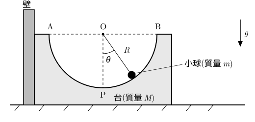
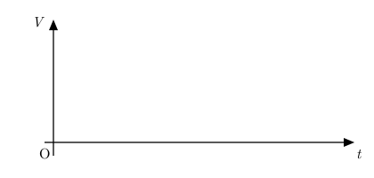

# 壁ぎわに置いた半円筒面の台と小球(型A 力学 / 2体系と拘束の切り替え / 想定30分 / 標準〜やや難)

狙い: `analysis/trend.md` の「繰り返し出る型」の上位2つ(2体系を重心運動+相対運動に分ける、つりあい位置まわりの微小振動)を1題に入れた。
拘束の切り替えは「壁に押しつけられている間は台が固定 → 最下点を過ぎた瞬間に台が壁から離れる」。

## 問題

次の文章を読んで，[ ] に適した式または数値を，{ } からは適切なものを一つ選びその番号を，それぞれの解答欄に記入せよ。また，**問1**，**問2**では，指示に従って，解答を解答欄に記入せよ。ただし，重力加速度の大きさを $g$ とし，空気抵抗は無視してよい。

**図1**のように，なめらかで水平な床の上に質量 $M$ の台が置かれ，台の左側面は床に固定された鉛直な壁に接している。台の上面には，半径 $R$ の半円筒形のなめらかなくぼみがあり，その断面は中心 O，最下点 P の半円である。くぼみの左端を A，右端を B とし，A，O，B は同じ高さにある。このくぼみの面上に，質量 $m$ の小球を置く。小球の大きさは無視できるものとする。小球の位置は，線分 OP と，O と小球を結ぶ線分とがなす角 $\theta$ で表し，P より右側を正，左側を負とする。運動はすべて**図1**の紙面(鉛直面)内で起こり，台は床から浮き上がらず，傾くこともないものとする。また，速度および力の水平成分については，右向きを正とし，符号にも注意せよ。

**(1)** 小球を A の位置($\theta = -90^\circ$)に置いて静かにはなしたところ，小球はくぼみの面に沿ってすべりおり，小球が P に達するまで台は静止したままであった。

小球が角 $\theta$($-90^\circ < \theta < 0^\circ$)の位置にあるとき，$\varphi = -\theta$ とおくと，小球の速さは [ ア ]，小球が面から受ける垂直抗力の大きさは [ イ ] である($g$, $R$, $m$, $\varphi$ のうち必要なもので表すこと)。このとき，台が壁から受ける力の大きさは [ ウ ] であり，これは $\varphi =$ [ エ ] ° のとき最大値 [ オ ] をとる。また，台が床から受ける垂直抗力の大きさは [ カ ] である。

小球が P に達したときの速さを $v_0$ とすると，$v_0 =$ [ キ ] である。小球をはなしてから P に達するまでの間に，台が壁から受けた力積の大きさは，$m$, $v_0$ を用いて [ ク ] と表される。

**(2)** 小球が P を通過すると，台は壁から離れて動き始めた。以下，**(2)** では $M$, $m$, $R$, $v_0$ のうち必要なものを用いて答えよ。

小球がくぼみの右側の面上で最高点に達したとき，床に対する小球の速度と台の速度は等しく，その値は [ ケ ] である。このときの小球の P からの高さは [ コ ] であり，小球は B に { サ: ①達して台から飛び出す，②ちょうど達する，③達しない }。

その後，小球は面をすべりおりて再び P に戻る。このときの床に対する小球の速度は [ シ ]，台の速度は [ ス ] である。したがって，$M > m$ のとき，このときの小球は床に対して { セ: ①右向きに動いている，②静止している，③左向きに動いている }。

このとき小球が面から受ける垂直抗力の大きさを $N_1$，**(1)** で小球が最初に P を通過する直前の垂直抗力の大きさを $N_0$ とすると，{ ソ: ① $N_1 > N_0$，② $N_1 = N_0$，③ $N_1 < N_0$ } である。

**問1** [ ソ ] の答を選んだ理由を，台とともに動く観測者の立場で考えて説明せよ。その際，小球が P にある瞬間の台の加速度に言及すること。

**(3)** 次に，台を再び壁に接して静止させ，小球を $\theta = -\theta_0$ の位置に置いて静かにはなした。ただし，$\theta_0$ は正で十分小さく，$|\theta|$ が $1$ に比べて十分小さいときに成り立つ近似式

$$\sin\theta \fallingdotseq \theta, \qquad \cos\theta \fallingdotseq 1 - \frac{\theta^2}{2}$$

を用いてよい。また，小球の鉛直方向の加速度は十分小さく，垂直抗力の大きさは $mg$ に等しいとしてよい。以下，**(3)** では $M$, $m$, $R$, $g$, $\theta_0$ のうち必要なものを用いて答えよ。

小球をはなした時刻を $t = 0$ とする。小球が最初に P に達する時刻は $t_1 =$ [ タ ] であり，そのときの小球の速さは [ チ ] である。

$t > t_1$ では，台は壁から離れて運動する。小球が角 $\theta$ の位置にあるとき，床に対する小球の加速度の水平成分は [ ツ ] $\times\,\theta$，台の加速度は [ テ ] $\times\,\theta$ と表される。小球の，台に対する水平方向の変位を $x$(P の真上にあるとき $x = 0$)とすると，$x \fallingdotseq R\theta$ であるから，台から見た小球の運動は周期 $T' =$ [ ト ] の単振動である。

台の速度は，小球が P を通過するたびに，$0$ と最大値 [ ナ ] を交互にとる。時刻 $t_1$ から $t_1 + T'$ までの間に，台が床の上を進む距離は [ ニ ] である。

**問2** $M = 3m$ の場合について，台の速度 $V$ と時刻 $t$ の関係を，$0 \leqq t \leqq t_1 + 2T'$ の範囲で，解答用紙に**図2**を描き写してグラフに表せ。なお，横軸には $t_1$，$t_1 + T'$，$t_1 + 2T'$ の値を，縦軸には $V$ の最大値を，それぞれ $R$, $g$, $\theta_0$ のうち必要なものを用いて書き入れること。

## 解答

| 空欄 | 答 |
|---|---|
| ア | $\sqrt{2gR\cos\varphi}$ |
| イ | $3mg\cos\varphi$ |
| ウ | $3mg\sin\varphi\cos\varphi$ |
| エ | $45$ |
| オ | $\dfrac{3}{2}mg$ |
| カ | $Mg + 3mg\cos^2\varphi$ |
| キ | $\sqrt{2gR}$ |
| ク | $mv_0$ |
| ケ | $\dfrac{m}{M+m}v_0$ |
| コ | $\dfrac{M}{M+m}R$ $\left(= \dfrac{Mv_0^2}{2(M+m)g}\right)$ |
| サ | ③ |
| シ | $\dfrac{m-M}{M+m}v_0$ |
| ス | $\dfrac{2m}{M+m}v_0$ |
| セ | ③ |
| ソ | ② |
| タ | $\dfrac{\pi}{2}\sqrt{\dfrac{R}{g}}$ |
| チ | $\theta_0\sqrt{gR}$ |
| ツ | $-g$ |
| テ | $\dfrac{m}{M}g$ |
| ト | $2\pi\sqrt{\dfrac{MR}{(M+m)g}}$ |
| ナ | $\dfrac{2m}{M+m}\theta_0\sqrt{gR}$ |
| ニ | $\dfrac{2\pi m\sqrt{M}}{(M+m)^{3/2}}R\theta_0$ |

**問1** 小球が P にある瞬間、小球が台に及ぼす力(垂直抗力の反作用)は鉛直下向きで水平成分をもたないので、台の加速度は $0$ である。したがってこの瞬間、台とともに動く観測者には慣性力が現れず、床に対する小球の速度を $v$、台の速度を $V$ とすると、小球は速さ $\lvert v - V\rvert$ で半径 $R$ の円運動をしているとして

$$N - mg = \frac{m(v - V)^2}{R}$$

が成り立つ。最初の通過では台が静止しているので相対速度の大きさは $v_0$。2回目は シ $-$ ス $= -v_0$ より、やはり $v_0$。よって

$$N_1 = N_0 = mg + \frac{mv_0^2}{R} = 3mg$$

**問2** $M = 3m$ のとき

$$T' = \pi\sqrt{\frac{3R}{g}}, \qquad V_{\max} = \frac{\theta_0}{2}\sqrt{gR}$$

$$V = \begin{cases} 0 & (0 \leqq t \leqq t_1) \\[4pt] \dfrac{\theta_0}{4}\sqrt{gR}\left\{1 - \cos\dfrac{2\pi(t - t_1)}{T'}\right\} & (t \geqq t_1) \end{cases}$$

グラフは、$t_1$ で傾き $0$ でなめらかに立ち上がり、$t_1 + \frac{1}{2}T'$ で最大値、$t_1 + T'$ で $0$(接線は水平)、$t_1 + \frac{3}{2}T'$ で再び最大、$t_1 + 2T'$ で $0$。$V$ は負にならない(台は壁に戻らない)。横軸の値は

$$t_1 = \frac{\pi}{2}\sqrt{\frac{R}{g}}, \qquad t_1 + T' = \frac{\pi}{2}\left(1 + 2\sqrt{3}\right)\sqrt{\frac{R}{g}}, \qquad t_1 + 2T' = \frac{\pi}{2}\left(1 + 4\sqrt{3}\right)\sqrt{\frac{R}{g}}$$

## 解説(どこで設定が切り替わり、何を転用するか)

**(1) 台が固定されている段階。** 小球は A から $R\cos\varphi$ だけ下がるので、力学的エネルギー保存より $v^2 = 2gR\cos\varphi$。中心向きの運動方程式

$$N - mg\cos\varphi = \frac{mv^2}{R}$$

から $N = 3mg\cos\varphi$。台が受ける力は $N$ の反作用(左下向き)で、水平成分 $N\sin\varphi$ が壁を押す。

$$3mg\sin\varphi\cos\varphi = \frac{3}{2}mg\sin 2\varphi$$

なので $\varphi = 45^\circ$ で最大。鉛直成分 $N\cos\varphi$ が床を押すので、床からの垂直抗力は $Mg + 3mg\cos^2\varphi$。

ク は、壁からの力積だけが系(小球+台)の水平方向の運動量を変えるので、P での運動量 $mv_0$ に等しい。ウ を時間で積分する必要はない。**ここで「系の運動量」に目を向けさせておくのが (2) への橋渡し。**

**(2) 壁から離れた後(切り替え)。** P を過ぎると $N$ の反作用の水平成分が右向きになり、台は壁から離れる。以後は水平方向の外力がないので、水平方向の運動量 $mv_0$ と力学的エネルギーが保存する。

最高点では小球が台に対して静止するので、速度は共通の値 $u$ になる。

$$(M+m)u = mv_0, \qquad \frac{1}{2}mv_0^2 = \frac{1}{2}(M+m)u^2 + mgH$$

から

$$H = \frac{Mv_0^2}{2(M+m)g} = \frac{M}{M+m}R < R$$

よって B に達しない。

再び P に戻ったときの小球の速度を $v$、台の速度を $V$ とする。P どうしなので位置エネルギーは同じで、

$$mv_0 = mv + MV, \qquad \frac{1}{2}mv_0^2 = \frac{1}{2}mv^2 + \frac{1}{2}MV^2$$

この2式を連立する。第2式を $m(v_0 - v)(v_0 + v) = MV^2$ と変形し、第1式 $m(v_0 - v) = MV$ で辺々割ると $v_0 + v = V$、すなわち

$$v - V = -v_0$$

(相対速度は大きさが変わらず、符号だけ反転する。)これと第1式から

$$v = \frac{m-M}{M+m}v_0, \qquad V = \frac{2m}{M+m}v_0$$

立てた2式は一次元の弾性衝突と同じ形なので、答も同じ形になる。ただし、それに気づく必要はなく、連立すれば出る。

ソ・問1 は「動く台の上で円運動の式を使ってよいか」を問う。一般には台が加速度をもつので慣性力が要るが、P の瞬間だけは台の加速度が $0$。ここを言えるかで差がつく。

**(3) 微小振動(前半の結果の転用)。** $0 \leqq t \leqq t_1$ は台が固定で、長さ $R$ の単振り子と同じ。周期 $2\pi\sqrt{R/g}$ の $\frac{1}{4}$ が $t_1$。速さは

$$v_0^2 = 2gR(1 - \cos\theta_0) \fallingdotseq gR\theta_0^2$$

$t > t_1$ では、小球の加速度の水平成分を $a$、台の加速度を $A$ として

$$ma = -N\sin\theta \fallingdotseq -mg\theta, \qquad MA = N\sin\theta \fallingdotseq mg\theta$$

相対加速度は

$$a - A = -g\left(1 + \frac{m}{M}\right)\theta = -\frac{(M+m)g}{MR}x$$

よって角振動数は $\omega' = \sqrt{\dfrac{(M+m)g}{MR}}$。**換算質量 $\dfrac{Mm}{M+m}$ を使った形と同じで、固定の場合より周期が短くなる。**

台の速度は、重心速度 $u = \dfrac{m}{M+m}v_0$ のまわりで振動し、$t_1$ で $0$ から始まるので

$$V = u\left\{1 - \cos\omega'(t - t_1)\right\}$$

最大値 $2u$ は、(2) の ス に (3) の $v_0 = \theta_0\sqrt{gR}$ を代入したものと一致する((2) の結果の転用)。1周期の間の台の移動距離は、$V$ の平均が $u$ なので $uT'$。

**検算。**

- $M \to \infty$ で コ $\to R$(A と同じ高さまで上がる)、シ $\to -v_0$、ス $\to 0$、ト $\to 2\pi\sqrt{R/g}$。固定した台の結果に一致。
- (3) の相対振動の角振幅は $\dfrac{v_0}{\omega' R} = \theta_0\sqrt{\dfrac{M}{M+m}}$。(2) の コ を微小角に直した $H = \dfrac{M}{M+m}R(1 - \cos\theta_0)$ から得る角振幅と一致。
- 次元: ニ は長さ、ナ は速さ。

## 出典・検証

- 題材は自作。用いた法則は教科書本文の範囲(力学的エネルギー保存、運動量保存、円運動の運動方程式、単振動)で、範囲外の事実は与えていない。コードブックの判定では L1(近似式 $\sin\theta \fallingdotseq \theta$、$\cos\theta \fallingdotseq 1 - \theta^2/2$ を数学手法として提示)。
- 先例との関係: 2014 I(台車上のばねと壁からの離脱)、2026 I(動く斜面台と小球)、2016 I(台上の球の重心速度グラフ)と同じ型。くぼみ+壁の組み合わせは 2010〜2026 の京大物理には出ていない。
- 数値検証: 台の位置を $X$ として、運動方程式

  $$(M+m)\ddot{X} + mR\left(\ddot\theta\cos\theta - \dot\theta^2\sin\theta\right) = 0, \qquad R\ddot\theta + \ddot{X}\cos\theta + g\sin\theta = 0$$

  (壁に接している間は $\ddot{X} = 0$)を刻み $10^{-5}\,\mathrm{s}$ で数値積分し、$M = 3$、$m = 1$、$R = 1$、$g = 9.8$ で次を確認した。
  - $\theta = -90^\circ$ ではなした場合: $v_0 = 4.4272$(式 $4.4272$)、最高点の高さ $0.75000$(式 $0.75$)、2回目の P で台 $2.2136$・小球 $-2.2136$(式 $\pm 2.2136$)、3回目の P で台 $0$・小球 $4.4272$。
  - $\theta_0 = 0.05\,\mathrm{rad}$ の場合: $t_1 = 0.50185$(式 $0.50177$)、$v_0 = 0.15651$(式 $0.15652$)、台の最大速度 $0.078254$(式 $0.078254$)、右側での角振幅 $0.043300$(式 $0.043301$)、$T' = 1.7387$(式 $1.7382$)。
- 未検証: 人間による試答はしていない。想定時間 30 分と難易度は見積もり。
