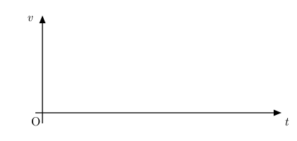
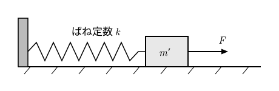

# レール上の導体棒と抵抗・コンデンサー・コイル(型B 電磁気 / 力学への読み替え / 想定30分 / 標準)

狙い: `analysis/trend.md` の「電磁気を力学の言葉に読み替える」「差分式 ΔQ/Δt、ΔI/Δt で追う」型。
端子につなぐ素子を 抵抗 → コンデンサー → コイル → コイルとコンデンサーの並列 と切り替え、同じ運動方程式を使い回す。
コンデンサーは「質量が増えたのと同じ」、コイルは「ばねと同じ」という対応を誘導に沿って見つけ、(4) でその2つを組み合わせる。

改訂(誘導量を本番に合わせた): 答えの数を 22 → 18 に減らし、運動方程式(i)、コイルの電圧の関係、ばね–物体系との対応(図4)を本文で与えた。図を 3 → 4 枚に増やした。問2 に「速さが最大の瞬間の電流」を加えて重くした。

## 問題

次の文章を読んで，[ ] に適した式を，{ } からは適切なものを一つ選びその番号を，それぞれの解答欄に記入せよ。また，**問1**，**問2**では，指示に従って，解答を解答欄に記入せよ。

**図1**のように，水平面内に，十分に長い2本の導体のレールが間隔 $\ell$ で平行に固定されている。レールの上には質量 $m$ の導体棒が置かれ，導体棒はレールと垂直を保ったまま，レールの上をなめらかに動くことができる。レールの左端には端子 P，Q があり，その間に素子を接続する。レールのある領域には，鉛直上向き(**図1**の紙面の裏から表の向き)に，磁束密度の大きさ $B$ の一様な磁場がかけられている。レールに沿って右向きに $x$ 軸をとり，導体棒の位置を $x$，速度を $v$，加速度を $\alpha$ とする。導体棒を流れる電流 $I$ は，**図1**の矢印の向きを正とする。導体棒とレールの電気抵抗，回路を流れる電流がつくる磁場，および空気抵抗は無視できるものとする。また，微小な時間 $\Delta t$ の間の量 $A$ の変化を $\Delta A$ と書く。

導体棒が右向きに動いているとき($v > 0$)，導体棒には，$I$ の正の向きに電流を流そうとする誘導起電力が生じ，その大きさは [ イ ] である。また，導体棒を正の向きの電流 $I$ が流れているとき，導体棒が磁場から受ける力は左向きで，その大きさは $IB\ell$ である。したがって，導体棒に右向きで大きさ $F$ の外力を加えているとき，導体棒の運動方程式は，PQ 間に接続する素子によらず

$$m\alpha = F - IB\ell \qquad \cdots\cdots \text{(i)}$$

と表される。以下では，素子ごとに電流 $I$ がどのように決まるかを調べ，式(i)を用いて導体棒の運動を考える。

**(1)** **図1**のように，PQ 間に抵抗値 $R$ の抵抗を接続する。時刻 $t = 0$ に，静止していた導体棒に，右向きで大きさ $F$ の一定の外力を加え始めた。

導体棒の速度が $v$ のとき，抵抗には誘導起電力に等しい電圧がかかるので，導体棒が磁場から受ける力の大きさは，$B$, $\ell$, $R$, $v$ を用いて [ ロ ] と表される。この力は速度に比例して大きくなるので，導体棒の加速度はしだいに小さくなり，十分に時間がたつと，導体棒の速度は一定値 [ ハ ] になる。このとき，外力が単位時間あたりにする仕事は，すべて抵抗で発生するジュール熱になっており，その値は [ ニ ] である([ ハ ]，[ ニ ] は $B$, $\ell$, $R$, $F$ のうち必要なもので表すこと)。

**(2)** 次に，PQ 間の抵抗を取り外し，**図2**(a)のように，電気容量 $C$ のコンデンサーを接続する。コンデンサーに電荷がない状態で，時刻 $t = 0$ に，静止していた導体棒に，右向きで大きさ $F$ の一定の外力を加え始めた。

回路には抵抗がないので，コンデンサーの電圧はつねに誘導起電力に等しい。したがって，導体棒の速度が $v$ のとき，コンデンサーに蓄えられている電気量は $Q =$ [ ホ ] である。電流は，コンデンサーの電気量の単位時間あたりの変化 $\dfrac{\Delta Q}{\Delta t}$ に等しく，また $\alpha = \dfrac{\Delta v}{\Delta t}$ であるから，$I =$ [ ヘ ] $\times\,\alpha$ と表される。

これを式(i)に代入して整理すると，$(m\,+$ [ ト ] $)\,\alpha = F$ となる。すなわち，コンデンサーを接続した導体棒は，質量が [ ト ] だけ大きくなった物体と同じように，一定の加速度で運動する。このとき，加速度が一定であるから，電流も一定である。また，導体棒が動き始めてから距離 $d$ だけ進んだとき，コンデンサーに蓄えられている静電エネルギーは [ チ ] である([ チ ] は $B$, $\ell$, $m$, $C$, $F$, $d$ のうち必要なもので表すこと)。

**問1** (1)の場合と(2)の場合のそれぞれについて，導体棒の速度 $v$ と時刻 $t$ の関係を表すグラフの概形を，解答用紙に**図3**を描き写して，同じ図の中に描け。その際，$t = 0$ におけるグラフの傾きの大小関係と，十分に時間がたったときのふるまいの違いがわかるように描き，それぞれに(1)，(2)と書き添えること。

**(3)** 次に，PQ 間のコンデンサーを取り外し，**図2**(b)のように，自己インダクタンス $L$ のコイルを接続する。外力は加えない($F = 0$)。$x = 0$ の位置に静止していた導体棒に，時刻 $t = 0$ に瞬間的に力を加えて，右向きに速さ $v_0$ を与えた。$t = 0$ にコイルを流れる電流は $0$ であった。

回路には抵抗がないので，コイルの両端の電圧 $L\dfrac{\Delta I}{\Delta t}$ はつねに誘導起電力に等しい。この関係に $v = \dfrac{\Delta x}{\Delta t}$ を用いると，電流の変化 $\Delta I$ は，導体棒の位置の変化 $\Delta x$ に比例することがわかる。$x = 0$ のとき $I = 0$ であったから，導体棒の位置が $x$ のときの電流は $I =$ [ リ ] である。

これを式(i)に代入すると，導体棒が磁場から受ける力は，$x$ に比例し，向きは $x$ と逆であることがわかる。これは，**図4**のように，ばね定数 $k$ のばねにつながれた物体が受ける力と同じ形であり，$k =$ [ ヌ ] のばねに相当する。したがって，導体棒は周期 [ ル ] の単振動をし，この運動における $x$ の最大値は [ ヲ ] である([ リ ]，[ ヌ ] は $B$, $\ell$, $L$, $x$ のうち，[ ル ]，[ ヲ ] は $B$, $\ell$, $m$, $L$, $v_0$ のうち，それぞれ必要なもので表すこと)。

**(4)** 最後に，**図2**(c)のように，PQ 間に(3)のコイルと(2)のコンデンサーを並列に接続する。コンデンサーに電荷がなく，コイルに電流が流れていない状態で，時刻 $t = 0$ に，$x = 0$ の位置に静止していた導体棒に，右向きで大きさ $F$ の一定の外力を加え始めた。

このとき，導体棒を流れる電流 $I$ は，コイルを流れる電流とコンデンサーを流れる電流の和である。コイルとコンデンサーの電圧はどちらも誘導起電力に等しいので，コイルを流れる電流は(3)の [ リ ] と同じ式で，コンデンサーを流れる電流は(2)と同じく [ ヘ ] $\times\,\alpha$ で表される。これらを式(i)に代入して整理すると，導体棒の運動は，**図4**において，質量 $m' =$ [ ワ ] の物体が，ばね定数 [ ヌ ] のばねにつながれ，右向きで大きさ $F$ の一定の力を受けているときの運動と同じであることがわかる。

したがって，導体棒は，磁場から受ける力と外力がつりあう位置 $x =$ [ カ ] を中心として，周期 [ ヨ ] の単振動をする。また，コンデンサーを接続せずコイルだけを接続して同じ操作を行った場合と比べると，導体棒の位置 $x$ の最大値は { タ: ①大きい，②等しい，③小さい }([ ワ ]〜[ ヨ ] は $B$, $\ell$, $m$, $C$, $L$, $F$ のうち必要なもので表すこと)。

**問2** (4)の運動について，導体棒の速さの最大値を求めよ。また，それは，コンデンサーを接続せずコイルだけを接続して同じ操作を行った場合の速さの最大値の何倍か。さらに，(4)の運動で導体棒の速さが最大になる瞬間に，コイルを流れている電流とコンデンサーを流れている電流を，それぞれ求めよ。導出過程も書くこと。

## 解答

| 空欄 | 答 |
|---|---|
| イ | $vB\ell$ |
| ロ | $\dfrac{B^2\ell^2}{R}v$ |
| ハ | $\dfrac{FR}{B^2\ell^2}$ |
| ニ | $\dfrac{F^2R}{B^2\ell^2}$ |
| ホ | $CB\ell v$ |
| ヘ | $CB\ell$ |
| ト | $CB^2\ell^2$ |
| チ | $\dfrac{CB^2\ell^2}{m + CB^2\ell^2}Fd$ |
| リ | $\dfrac{B\ell}{L}x$ |
| ヌ | $\dfrac{B^2\ell^2}{L}$ |
| ル | $\dfrac{2\pi\sqrt{mL}}{B\ell}$ |
| ヲ | $\dfrac{v_0\sqrt{mL}}{B\ell}$ |
| ワ | $m + CB^2\ell^2$ |
| カ | $\dfrac{FL}{B^2\ell^2}$ |
| ヨ | $\dfrac{2\pi\sqrt{(m + CB^2\ell^2)L}}{B\ell}$ |
| タ | ② |

**問1** (1) は原点を傾き $\dfrac{F}{m}$ で出発し、しだいに傾きが小さくなって、一定値 $\dfrac{FR}{B^2\ell^2}$(水平な漸近線)に下から近づく、上に凸の曲線。(2) は原点を通る傾き $\dfrac{F}{m + CB^2\ell^2}$ の直線で、いつまでも増え続ける。$t = 0$ での傾きは (1) のほうが大きいので、はじめは (1) が上にあり、やがて (2) の直線が (1) の曲線と交わって追い越す。

**問2** 単振動の中心は $x_0 = \dfrac{FL}{B^2\ell^2}$、角振動数は $\omega' = \sqrt{\dfrac{k}{m'}} = \dfrac{B\ell}{\sqrt{(m + CB^2\ell^2)L}}$。$t = 0$ に $x = 0$ で静止しているから振幅は $x_0$ で、速さの最大値は

$$v_{\max} = x_0\,\omega' = \frac{F}{B\ell}\sqrt{\frac{L}{m + CB^2\ell^2}}$$

コイルだけの場合は $C = 0$ とおいて $\dfrac{F}{B\ell}\sqrt{\dfrac{L}{m}}$。よって

$$\sqrt{\frac{m}{m + CB^2\ell^2}}\ \text{倍}$$

速さが最大になるのは振動の中心 $x = x_0$ を通過する瞬間で、このとき加速度は $\alpha = 0$。したがって

$$\text{コイルの電流} = \frac{B\ell}{L}x_0 = \frac{F}{B\ell}, \qquad \text{コンデンサーの電流} = CB\ell\,\alpha = 0$$

(このとき式(i)は $F = IB\ell$ となり、外力と磁場からの力がつりあっている。)

## 解説(どこで設定が切り替わり、何を転用するか)

**全体の手順。** 式(i) $m\alpha = F - IB\ell$ は素子によらない。素子ごとに変わるのは $I$ の決まり方だけで、「素子の電圧 = 誘導起電力 $vB\ell$」から $I$ を出して (i) に入れる。**本文がこの手順を最初に明示しているのが誘導で、(1)〜(4) はその4回の繰り返し。**

向きの確認: 磁場は紙面の裏から表、導体棒が右に動くと、棒の中の正電荷は図の下向き(矢印の向き)に力を受ける。したがって $v > 0$ のとき起電力は $I$ の正の向き。その電流が磁場から受ける力は左向き。

**(1) 抵抗。** $I = \dfrac{vB\ell}{R}$ より力は $\dfrac{B^2\ell^2}{R}v$。(i) で $\alpha = 0$ とおいて終端速度 $v_\infty = \dfrac{FR}{B^2\ell^2}$。ジュール熱は $Fv_\infty = \dfrac{F^2R}{B^2\ell^2}$。

**(2) コンデンサー。** $Q = CB\ell v$ より

$$I = \frac{\Delta Q}{\Delta t} = CB\ell\,\frac{\Delta v}{\Delta t} = CB\ell\,\alpha$$

(i) に入れると $(m + CB^2\ell^2)\,\alpha = F$。距離 $d$ 進んだとき $v^2 = 2\alpha d$ だから

$$\frac{1}{2}C(vB\ell)^2 = CB^2\ell^2\alpha d = \frac{CB^2\ell^2}{m + CB^2\ell^2}Fd$$

検算: 運動エネルギーは $\dfrac{1}{2}mv^2 = \dfrac{m}{m + CB^2\ell^2}Fd$ で、和は外力の仕事 $Fd$ に一致する。

**(3) コイル。**

$$L\frac{\Delta I}{\Delta t} = B\ell\,\frac{\Delta x}{\Delta t} \quad\Longrightarrow\quad \Delta I = \frac{B\ell}{L}\Delta x \quad\Longrightarrow\quad I = \frac{B\ell}{L}x$$

力は $-IB\ell = -\dfrac{B^2\ell^2}{L}x$。角振動数 $\omega = \dfrac{B\ell}{\sqrt{mL}}$、振幅 $\dfrac{v_0}{\omega}$。

検算: 電流の最大値は $\dfrac{B\ell}{L}\cdot\dfrac{v_0}{\omega} = v_0\sqrt{\dfrac{m}{L}}$ で、$\dfrac{1}{2}mv_0^2 = \dfrac{1}{2}LI_{\max}^2$ が成り立つ。

**(4) 並列(前半の結果の転用)。**

$$m\alpha = F - \left(\frac{B\ell}{L}x + CB\ell\,\alpha\right)B\ell \quad\Longrightarrow\quad (m + CB^2\ell^2)\,\alpha = F - \frac{B^2\ell^2}{L}x$$

中心は力のつりあいの位置 $x_0 = \dfrac{FL}{B^2\ell^2}$ で、質量によらない。$x = 0$ から静かに動き出すので振幅は $x_0$、最大値は $2x_0$。**これも質量によらないので、コンデンサーの有無で変わらない(タ は ②)。** 変わるのは周期(長くなる)と最大の速さ(小さくなる)。「物体を一定の力 $F$ で引き始めると、ばねの最大の伸びは物体の質量によらず $\dfrac{2F}{k}$ になる」という力学の事実に読み替えられるかを見ている。

問2 の後半は、振動の中心で $\alpha = 0$ であることから、コンデンサーには電流が流れていない(充電が最大で、電流の向きが切り替わる瞬間)と気づけるかを問う。

**検算。**

- $C \to 0$ で ト $\to 0$、ヨ $\to$ ル。
- 次元: $CB^2\ell^2$ は質量、$\dfrac{B^2\ell^2}{L}$ は力÷長さ、$\dfrac{B^2\ell^2}{R}$ は力÷速さ。
- (4) のエネルギー: $x = 2x_0$ で $v = 0$。外力の仕事 $2Fx_0$ と、コイルのエネルギー $\dfrac{1}{2}L\left(\dfrac{B\ell}{L}\cdot 2x_0\right)^2 = 2Fx_0$ が一致(このときコンデンサーの電圧は $0$)。

## 出典・検証

- 題材は自作。用いた法則は教科書本文の範囲(誘導起電力 $vB\ell$、電流が磁場から受ける力、コンデンサー $Q = CV$、コイルの自己誘導 $V = L\,\Delta I/\Delta t$、単振動)で、範囲外の事実は与えていない。コードブックの判定では L1(導体棒+コンデンサーの「見かけの質量」、導体棒+コイルの単振動は受験定番)。
- 先例との関係: 2016 II(磁場中の導体棒+抵抗+コイル、電気振動とばね–質点系の対応)、2013 II(極板の単振動)、2020 II・2021 II(差分式で回路を追う)と同じ型。コンデンサーとコイルを並列にして「質量とばね」を同時に効かせる設定は 2010〜2026 の京大物理には出ていない。
- 検証: 上の「検算」のとおり、極限・次元・エネルギー収支を手計算で確認した。数値シミュレーションはしていない。
- 未検証: 人間による試答はしていない。想定時間 30 分と難易度は見積もり。
