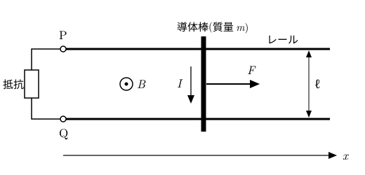
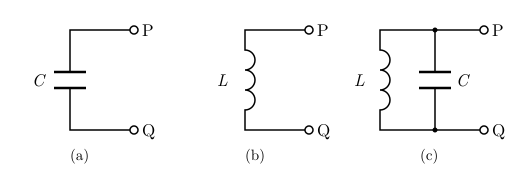

# レール上の導体棒と抵抗・コンデンサー・コイル(型B 電磁気 / 力学への読み替え / 想定30分 / 標準)

狙い: `analysis/trend.md` の「電磁気を力学の言葉に読み替える」「差分式 ΔQ/Δt、ΔI/Δt で追う」型。
端子につなぐ素子を 抵抗 → コンデンサー → コイル → コイルとコンデンサーの並列 と切り替え、同じ運動方程式の立て方を使い回す。
コンデンサーは「質量が増えたのと同じ」、コイルは「ばねと同じ」という対応を自分で見つけ、(4) でその2つを組み合わせる。

## 問題

次の文章を読んで，[ ] に適した式を，{ } からは適切なものを一つ選びその番号を，それぞれの解答欄に記入せよ。また，**問1**，**問2**では，指示に従って，解答を解答欄に記入せよ。

**図1**のように，水平面内に，十分に長い2本の導体のレールが間隔 $\ell$ で平行に固定されている。レールの上には質量 $m$ の導体棒が置かれ，導体棒はレールと垂直を保ったまま，レールの上をなめらかに動くことができる。レールの左端には端子 P，Q があり，その間に素子を接続する。レールのある領域には，鉛直上向き(**図1**の紙面の裏から表の向き)に，磁束密度の大きさ $B$ の一様な磁場がかけられている。レールに沿って右向きに $x$ 軸をとり，導体棒の位置を $x$，速度を $v$，加速度を $\alpha$ とする。導体棒を流れる電流 $I$ は，**図1**の矢印の向きを正とする。導体棒とレールの電気抵抗，回路を流れる電流がつくる磁場，および空気抵抗は無視できるものとする。また，微小な時間 $\Delta t$ の間の量 $A$ の変化を $\Delta A$ と書く。

**(1)** **図1**のように，PQ 間に抵抗値 $R$ の抵抗を接続する。時刻 $t = 0$ に，静止していた導体棒に，右向きで大きさ $F$ の一定の外力を加え始めた。

導体棒の速度が $v$ のとき，導体棒に生じる誘導起電力の大きさは [ イ ] であり，電流は $I =$ [ ロ ] である。したがって，このときの導体棒の加速度は $\alpha =$ [ ハ ] と表される。十分に時間がたつと，導体棒の速度は一定値 [ ニ ] になり，このとき抵抗で単位時間あたりに発生するジュール熱は [ ホ ] である([ ニ ]，[ ホ ] は $B$, $\ell$, $R$, $F$ のうち必要なもので表すこと)。

**(2)** 次に，PQ 間の抵抗を取り外し，**図2**(a)のように，電気容量 $C$ のコンデンサーを接続する。コンデンサーに電荷がない状態で，時刻 $t = 0$ に，静止していた導体棒に，右向きで大きさ $F$ の一定の外力を加え始めた。

導体棒の速度が $v$ のとき，コンデンサーに蓄えられている電気量は [ ヘ ] である。電流はコンデンサーの電気量の単位時間あたりの変化に等しいから，$I =$ [ ト ] $\times\,\alpha$ と表される。これを導体棒の運動方程式に用いると，$\alpha =$ [ チ ] が得られる。したがって，電流は { ヌ: ①時間とともに増加する，②時間によらず一定である，③時間とともに減少する }。また，導体棒が動き始めてから距離 $d$ だけ進んだとき，コンデンサーに蓄えられている静電エネルギーは [ リ ] である([ チ ]，[ リ ] は $B$, $\ell$, $m$, $C$, $F$, $d$ のうち必要なもので表すこと)。

**問1** (1) の場合と(2) の場合のそれぞれについて，導体棒の速度 $v$ と時刻 $t$ の関係を表すグラフの概形を，解答用紙に**図3**を描き写して，同じ図の中に描け。その際，$t = 0$ におけるグラフの傾きの大小関係と，十分に時間がたったときのふるまいの違いがわかるように描き，それぞれに(1)，(2)と書き添えること。

**(3)** 次に，PQ 間のコンデンサーを取り外し，**図2**(b)のように，自己インダクタンス $L$ のコイルを接続する。外力は加えない。$x = 0$ の位置に静止していた導体棒に，時刻 $t = 0$ に瞬間的に力を加えて，右向きに速さ $v_0$ を与えた。$t = 0$ にコイルを流れる電流は $0$ であった。

導体棒の速度が $v$ のとき，電流の単位時間あたりの変化は $\dfrac{\Delta I}{\Delta t} =$ [ ル ] である。$v = \dfrac{\Delta x}{\Delta t}$ であることと，$x = 0$ のとき $I = 0$ であることを用いると，導体棒の位置が $x$ のときの電流は $I =$ [ ヲ ] と表される。したがって，導体棒が磁場から受ける力は [ ワ ] となり，導体棒は周期 [ カ ] の単振動をする。この運動における $x$ の最大値は [ ヨ ]，電流の最大値は [ タ ] である([ ル ]〜[ ワ ] は $B$, $\ell$, $L$, $v$, $x$ のうち，[ カ ]〜[ タ ] は $B$, $\ell$, $m$, $L$, $v_0$ のうち，それぞれ必要なもので表すこと)。

**(4)** 最後に，**図2**(c)のように，PQ 間に(3) のコイルと(2) のコンデンサーを並列に接続する。コンデンサーに電荷がなく，コイルに電流が流れていない状態で，時刻 $t = 0$ に，$x = 0$ の位置に静止していた導体棒に，右向きで大きさ $F$ の一定の外力を加え始めた。

コイルを流れる電流は(3) の [ ヲ ] と同じ式で，コンデンサーを流れる電流は(2)と同様に [ ト ] $\times\,\alpha$ で表されるので，導体棒の運動方程式は [ レ ] $\times\,\alpha = F - \dfrac{B^2\ell^2}{L}\,x$ と書ける。これより，導体棒は $x =$ [ ソ ] の位置を中心とする周期 [ ツ ] の単振動をする。コンデンサーを接続せずコイルだけを接続して同じ操作を行った場合と比べると，導体棒の位置 $x$ の最大値は { ネ: ①大きい，②等しい，③小さい }。

**問2** (4) の運動における導体棒の速さの最大値を求めよ。また，それは，コンデンサーを接続せずコイルだけを接続して同じ操作を行った場合の速さの最大値の何倍か。導出過程も含めて答えよ。

## 解答

| 空欄 | 答 |
|---|---|
| イ | $vB\ell$ |
| ロ | $\dfrac{vB\ell}{R}$ |
| ハ | $\dfrac{F}{m} - \dfrac{B^2\ell^2}{mR}v$ |
| ニ | $\dfrac{FR}{B^2\ell^2}$ |
| ホ | $\dfrac{F^2R}{B^2\ell^2}$ |
| ヘ | $CB\ell v$ |
| ト | $CB\ell$ |
| チ | $\dfrac{F}{m + CB^2\ell^2}$ |
| ヌ | ② |
| リ | $\dfrac{CB^2\ell^2}{m + CB^2\ell^2}Fd$ |
| ル | $\dfrac{B\ell}{L}v$ |
| ヲ | $\dfrac{B\ell}{L}x$ |
| ワ | $-\dfrac{B^2\ell^2}{L}x$ |
| カ | $\dfrac{2\pi\sqrt{mL}}{B\ell}$ |
| ヨ | $\dfrac{v_0\sqrt{mL}}{B\ell}$ |
| タ | $v_0\sqrt{\dfrac{m}{L}}$ |
| レ | $m + CB^2\ell^2$ |
| ソ | $\dfrac{FL}{B^2\ell^2}$ |
| ツ | $\dfrac{2\pi\sqrt{(m + CB^2\ell^2)L}}{B\ell}$ |
| ネ | ② |

**問1** (1) は原点を傾き $\dfrac{F}{m}$ で出発し、しだいに傾きが小さくなって、一定値 $\dfrac{FR}{B^2\ell^2}$(水平な漸近線)に下から近づく、上に凸の曲線。(2) は原点を通る傾き $\dfrac{F}{m + CB^2\ell^2}$ の直線で、いつまでも増え続ける。$t = 0$ での傾きは (1) のほうが大きいので、はじめは (1) が上にあり、やがて (2) の直線が (1) の曲線と交わって追い越す。

**問2** 単振動の中心は $x_0 = \dfrac{FL}{B^2\ell^2}$、角振動数は $\omega' = \dfrac{B\ell}{\sqrt{(m + CB^2\ell^2)L}}$。$t = 0$ に $x = 0$ で静止しているから振幅は $x_0$ で、速さの最大値は

$$v_{\max} = x_0\,\omega' = \frac{F}{B\ell}\sqrt{\frac{L}{m + CB^2\ell^2}}$$

コイルだけの場合は $C = 0$ とおいて $\dfrac{F}{B\ell}\sqrt{\dfrac{L}{m}}$。よって

$$\sqrt{\frac{m}{m + CB^2\ell^2}}\ \text{倍}$$

## 解説(どこで設定が切り替わり、何を転用するか)

**向きの確認。** 磁場は紙面の裏から表、導体棒が右に動くと、棒の中の正電荷は図の下向き(矢印の向き)に力を受ける。したがって $v > 0$ のとき誘導起電力は $I$ の正の向きに電流を流そうとする。その電流が磁場から受ける力は左向きで、導体棒の運動方程式は素子によらず

$$m\alpha = F - IB\ell$$

以下、素子ごとに $I$ の式だけが変わる。**これが全体を貫く「手順」。**

**(1) 抵抗。** $I = \dfrac{vB\ell}{R}$ を代入して $m\alpha = F - \dfrac{B^2\ell^2}{R}v$。$\alpha = 0$ で終端速度 $v_\infty = \dfrac{FR}{B^2\ell^2}$。このときジュール熱は $RI^2 = Fv_\infty = \dfrac{F^2R}{B^2\ell^2}$(外力の仕事率に等しい)。

**(2) コンデンサー。** 抵抗がないので、コンデンサーの電圧は常に起電力 $vB\ell$ に等しく $Q = CB\ell v$。

$$I = \frac{\Delta Q}{\Delta t} = CB\ell\,\frac{\Delta v}{\Delta t} = CB\ell\,\alpha$$

運動方程式に入れると

$$m\alpha = F - CB^2\ell^2\alpha \quad\Longrightarrow\quad (m + CB^2\ell^2)\,\alpha = F$$

**コンデンサーは、導体棒の質量が $CB^2\ell^2$ だけ増えたのと同じはたらきをする。** 加速度が一定なので電流も一定。距離 $d$ 進んだとき $v^2 = 2\alpha d$ だから

$$\frac{1}{2}C(vB\ell)^2 = CB^2\ell^2\alpha d = \frac{CB^2\ell^2}{m + CB^2\ell^2}Fd$$

検算: 運動エネルギーは $\dfrac{1}{2}mv^2 = \dfrac{m}{m + CB^2\ell^2}Fd$ で、和は外力の仕事 $Fd$ に一致する。

**(3) コイル。** 抵抗がないので、コイルの両端の電圧 $L\dfrac{\Delta I}{\Delta t}$ が起電力 $vB\ell$ に等しい。

$$\frac{\Delta I}{\Delta t} = \frac{B\ell}{L}\,\frac{\Delta x}{\Delta t} \quad\Longrightarrow\quad \Delta I = \frac{B\ell}{L}\Delta x \quad\Longrightarrow\quad I = \frac{B\ell}{L}x$$

($x = 0$ で $I = 0$ を使った。)力は $-IB\ell = -\dfrac{B^2\ell^2}{L}x$。**コイルは、ばね定数 $\dfrac{B^2\ell^2}{L}$ のばねと同じはたらきをする。** 角振動数 $\omega = \dfrac{B\ell}{\sqrt{mL}}$、振幅 $\dfrac{v_0}{\omega}$、電流の最大値は $\dfrac{B\ell}{L}\cdot\dfrac{v_0}{\omega} = v_0\sqrt{\dfrac{m}{L}}$。

検算: $\dfrac{1}{2}mv_0^2 = \dfrac{1}{2}LI_{\max}^2$(運動エネルギーがすべてコイルのエネルギーになる)。

**(4) 並列(前半の結果の転用)。** 導体棒を流れる電流は、コイルの電流とコンデンサーの電流の和。どちらの両端の電圧も $vB\ell$ なので、(2)(3) の式がそのまま使える。

$$m\alpha = F - \left(\frac{B\ell}{L}x + CB\ell\,\alpha\right)B\ell \quad\Longrightarrow\quad (m + CB^2\ell^2)\,\alpha = F - \frac{B^2\ell^2}{L}x$$

「質量 $m + CB^2\ell^2$ の物体が、ばね定数 $\dfrac{B^2\ell^2}{L}$ のばねにつながれ、一定の力 $F$ を受ける」のと同じ。中心は力のつりあいの位置 $x_0 = \dfrac{FL}{B^2\ell^2}$ で、質量によらない。$x = 0$ から静かに動き出すので振幅は $x_0$、最大値は $2x_0$。**これも質量によらないので、コンデンサーの有無で変わらない(ネ は ②)。** 変わるのは周期(長くなる)と最大の速さ(小さくなる)。

**検算。**

- $C \to 0$ で チ $\to \dfrac{F}{m}$、ツ $\to$ カ。
- 次元: $CB^2\ell^2$ は質量、$\dfrac{B^2\ell^2}{L}$ は力÷長さ、$\dfrac{B^2\ell^2}{R}$ は力÷速さ。
- (4) のエネルギー: $x = 2x_0$ で $v = 0$。外力の仕事 $2Fx_0$ と、コイルのエネルギー $\dfrac{1}{2}L\left(\dfrac{B\ell}{L}\cdot 2x_0\right)^2 = 2Fx_0$ が一致(このときコンデンサーの電圧は $0$)。

## 出典・検証

- 題材は自作。用いた法則は教科書本文の範囲(誘導起電力 $vB\ell$、電流が磁場から受ける力、コンデンサー $Q = CV$、コイルの自己誘導 $V = L\,\Delta I/\Delta t$、単振動)で、範囲外の事実は与えていない。コードブックの判定では L1(導体棒+コンデンサーの「見かけの質量」、導体棒+コイルの単振動は受験定番)。
- 先例との関係: 2016 II(磁場中の導体棒+抵抗+コイル、電気振動とばね–質点系の対応)、2013 II(極板の単振動)、2020 II・2021 II(差分式で回路を追う)と同じ型。コンデンサーとコイルを並列にして「質量とばね」を同時に効かせる設定は 2010〜2026 の京大物理には出ていない。
- 検証: 上の「検算」のとおり、極限・次元・エネルギー収支を手計算で確認した。数値シミュレーションはしていない。
- 未検証: 人間による試答はしていない。想定時間 30 分と難易度は見積もり。
