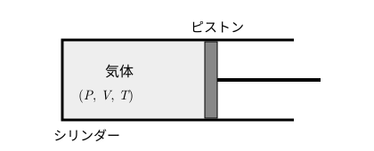

# 分子間に引力がはたらく気体(型C 熱 / 理想気体の手順を別の系でやり直す / 想定30分 / 標準〜やや難)

狙い: `analysis/trend.md` で直近の L2 が集中している型(2022 III ゴムひも、2025 III(2) $U = 3PV$ の気体)。
前半で理想気体の手順(第一法則の微小変化 → 断熱の式、等温での吸熱、自由膨張)を確認し、後半で状態方程式と内部エネルギーを差し替えて同じ手順をやり直させる。
「変わるもの(圧力、自由膨張での温度)」と「変わらないもの(断熱の式、等温での吸熱、熱効率)」を見分けさせるのが核。
コードブックの判定では L2(モデルの提示: 状態方程式と内部エネルギーの式)。名称(ファンデルワールス)は伏せた。

## 問題

次の文章を読んで，[ ] に適した式または数値を，{ } からは適切なものを一つ選びその番号を，それぞれの解答欄に記入せよ。また，**問1**，**問2**では，指示に従って，解答を解答欄に記入せよ。ただし，気体定数を $R$ とする。

以下では，物質量 $1\,\mathrm{mol}$ の気体の状態変化を考える。気体の圧力を $P$，体積を $V$，絶対温度を $T$，内部エネルギーを $U$ とし，微小な変化におけるこれらの変化量を $\Delta P$，$\Delta V$，$\Delta T$，$\Delta U$ と書く。微小な変化では，気体が外部にする仕事は $P\Delta V$ と表され，微小量どうしの積は無視してよい。また，必要であれば，次の(i)，(ii)を用いてよい。

(i) $|\Delta V|$ が $V$ に比べて十分小さいとき，$\dfrac{1}{V + \Delta V} \fallingdotseq \dfrac{1}{V} - \dfrac{\Delta V}{V^2}$ が成り立つ。

(ii) ある状態変化の間，微小な変化について $\dfrac{\Delta T}{T} = -k\,\dfrac{\Delta V}{V}$($k$ は定数)がつねに成り立つならば，その状態変化の間，$TV^k$ は一定に保たれる。

**(1)** まず，単原子分子理想気体の場合を考える。

この気体の内部エネルギーは，$R$, $T$ を用いて $U =$ [ あ ] と表される。気体をゆっくりと断熱変化させるとき，熱力学第一法則と状態方程式を用いると，微小な変化について $\dfrac{\Delta T}{T} =$ [ い ] $\times \dfrac{\Delta V}{V}$ が成り立つ。したがって，(ii)より，この断熱変化の間，$TV^{c}$($c =$ [ う ])は一定に保たれる。また，温度 $T$ を一定に保ったまま，体積を $V$ から $V + \Delta V$ までゆっくりと微小変化させるとき，気体が吸収する熱量は [ え ] である。

次に，**図1**のように，断熱容器を仕切りで体積 $V_0$ ずつの2つの部分に分け，一方に温度 $T_0$ の気体を入れ，他方を真空にする。仕切りを取り除き，十分に時間がたつと，気体は容器全体に広がって一様になる。この過程で，気体は外部に仕事をせず，熱の出入りもない。したがって，気体の温度は { お: ①上がる，②変わらない，③下がる }。

**(2)** 次に，理想気体とは異なる，ある気体 G を考える。$1\,\mathrm{mol}$ の気体 G の圧力と内部エネルギーは，正の定数 $a$ を用いて

$$P = \frac{RT}{V} - \frac{a}{V^2}, \qquad U = \frac{3}{2}RT - \frac{a}{V}$$

と表されるものとする。以下では，つねに $RT > \dfrac{a}{V}$ が成り立つ範囲で考える。

同じ温度，同じ体積で比べると，気体 G の圧力は単原子分子理想気体の圧力より { か: ①大きい，②小さい }。これは，気体 G の分子の間に { き: ①引力，②斥力 } がはたらいていると考えると理解できる。

気体 G の体積を一定に保ったまま，温度を $\Delta T$ だけ上げるのに必要な熱量は [ く ] である。

**図1**の容器の一方に，温度 $T_0$ の気体 G を入れ，他方を真空にして，(1)と同じように仕切りを取り除いた。十分に時間がたったあとの気体 G の温度は [ け ] である($R$, $a$, $T_0$, $V_0$ で表すこと)。

次に，気体 G をゆっくりと断熱変化させる場合を考える。体積が $V$ から $V + \Delta V$，温度が $T$ から $T + \Delta T$ に微小変化するとき，(i)を用いると，内部エネルギーの変化は $\Delta U = \dfrac{3}{2}R\,\Delta T\,+$ [ こ ] $\times\,\Delta V$ と表される。これと熱力学第一法則から，$\dfrac{\Delta T}{T} =$ [ さ ] $\times \dfrac{\Delta V}{V}$ が得られる。したがって，温度 $T_0$，体積 $V_0$ の状態から，体積が $2V_0$ になるまでゆっくりと断熱膨張させると，気体 G の温度は $T_0$ の [ し ] 倍になる。

また，気体 G の温度 $T$ を一定に保ったまま，体積を $V$ から $V + \Delta V$ までゆっくりと微小変化させるとき，気体 G が吸収する熱量は [ す ] である。

**問1** 単原子分子理想気体を，絶対温度 $T_{\mathrm{H}}$ の等温膨張，断熱膨張，絶対温度 $T_{\mathrm{L}}$($T_{\mathrm{L}} < T_{\mathrm{H}}$)の等温圧縮，断熱圧縮の順に，ゆっくりと変化させてもとの状態に戻すサイクルでは，等温膨張で吸収する熱量 $Q_{\mathrm{H}}$ と，等温圧縮で放出する熱量 $Q_{\mathrm{L}}$ の間に，$\dfrac{Q_{\mathrm{L}}}{Q_{\mathrm{H}}} = \dfrac{T_{\mathrm{L}}}{T_{\mathrm{H}}}$ の関係が成り立つことが知られている。気体 G を用いて，同じ温度 $T_{\mathrm{H}}$，$T_{\mathrm{L}}$ の間で同様のサイクルを行うとき，その熱効率を $T_{\mathrm{H}}$，$T_{\mathrm{L}}$ を用いて表せ。また，そのように考えた理由を，[ さ ] と [ す ] の結果にもとづいて説明せよ。

**(3)** 最後に，気体 G を用いた次のサイクルを考える。

過程 A→B: **図1**の容器で，温度 $T_0$，体積 $V_0$ の状態 A から，仕切りを取り除いて体積 $2V_0$ の状態 B にする。

過程 B→C: 体積を $2V_0$ に保ったまま加熱し，温度 $T_0$ の状態 C にする。

過程 C→A: 温度を $T_0$ に保ったまま，ゆっくりと圧縮して状態 A に戻す。

過程 B→C で気体 G が吸収する熱量は [ せ ] である($R$, $a$, $T_0$, $V_0$ のうち必要なもので表すこと)。また，過程 C→A で気体 G が放出する熱量を $Q$ とすると，$Q$ は [ せ ] より { そ: ①大きい，②小さい }。

**問2** [ そ ] の答を選んだ理由を，1サイクルの間に気体 G が外部にした仕事の符号に着目して説明せよ。

## 解答

| 空欄 | 答 |
|---|---|
| あ | $\dfrac{3}{2}RT$ |
| い | $-\dfrac{2}{3}$ |
| う | $\dfrac{2}{3}$ |
| え | $\dfrac{RT}{V}\Delta V$ |
| お | ② |
| か | ② |
| き | ① |
| く | $\dfrac{3}{2}R\,\Delta T$ |
| け | $T_0 - \dfrac{a}{3RV_0}$ |
| こ | $\dfrac{a}{V^2}$ |
| さ | $-\dfrac{2}{3}$ |
| し | $2^{-\frac{2}{3}}$ $\left(= \dfrac{1}{\sqrt[3]{4}}\right)$ |
| す | $\dfrac{RT}{V}\Delta V$ |
| せ | $\dfrac{a}{2V_0}$ |
| そ | ① |

**問1** 熱効率は $1 - \dfrac{T_{\mathrm{L}}}{T_{\mathrm{H}}}$。

理由: [ さ ] より、気体 G の断熱変化でも理想気体と同じく $TV^{2/3}$ が一定なので、2つの断熱過程が結ぶ体積の比は理想気体のサイクルと同じになる。また [ す ] より、等温過程の各微小変化で吸収する熱量 $\dfrac{RT}{V}\Delta V$ も理想気体と同じ式である。したがって、同じ温度・同じ体積をたどるサイクルでは、$Q_{\mathrm{H}}$、$Q_{\mathrm{L}}$ はどちらも理想気体の場合と等しく、$\dfrac{Q_{\mathrm{L}}}{Q_{\mathrm{H}}} = \dfrac{T_{\mathrm{L}}}{T_{\mathrm{H}}}$ が成り立つ。1サイクルで内部エネルギーはもとに戻るから、気体がした仕事は $Q_{\mathrm{H}} - Q_{\mathrm{L}}$ で、熱効率は

$$\frac{Q_{\mathrm{H}} - Q_{\mathrm{L}}}{Q_{\mathrm{H}}} = 1 - \frac{T_{\mathrm{L}}}{T_{\mathrm{H}}}$$

**問2** 過程 A→B(真空への膨張)と過程 B→C(定積変化)では気体は仕事をしない。過程 C→A は圧縮で、圧力は正だから、気体は外部から仕事をされる。したがって、1サイクルの間に気体が外部にした仕事は負である。1サイクルで内部エネルギーはもとに戻るので、熱力学第一法則より、(吸収した熱量)$-$(放出した熱量)$=$(外部にした仕事)$< 0$。吸収するのは過程 B→C の [ せ ] だけ、放出するのは過程 C→A の $Q$ だけだから、$Q$ は [ せ ] より大きい。

## 解説(どこで設定が切り替わり、何を転用するか)

**(1) 理想気体での手順の確認。** 断熱の微小変化では、第一法則 $\Delta U + P\Delta V = 0$ に $\Delta U = \dfrac{3}{2}R\Delta T$、$P = \dfrac{RT}{V}$ を入れて

$$\frac{3}{2}R\,\Delta T = -\frac{RT}{V}\Delta V \quad\Longrightarrow\quad \frac{\Delta T}{T} = -\frac{2}{3}\,\frac{\Delta V}{V}$$

(ii) より $TV^{2/3}$ が一定(ポアソンの式)。等温の微小変化では $\Delta U = 0$ なので、吸収する熱量は仕事 $P\Delta V = \dfrac{RT}{V}\Delta V$ に等しい。真空への膨張は仕事も熱もないので $\Delta U = 0$、理想気体の $U$ は $T$ だけで決まるから温度は変わらない。

**ここまでの「手順」(第一法則に $U$ と $P$ の式を入れる)を、(2) でそのまま使う。**

**(2) モデルの差し替え。** 圧力は $\dfrac{a}{V^2}$ だけ小さい。分子どうしが引き合うと、壁に向かう分子が内側に引き戻されるので、壁を押す力が弱まる。

定積では仕事がないので、熱量は $\Delta U = \dfrac{3}{2}R\Delta T$($V$ が一定なので $-\dfrac{a}{V}$ の項は変わらない)。

真空への膨張では、理想気体と同じく $\Delta U = 0$。ただし今度は $U$ が $V$ にもよるので

$$\frac{3}{2}RT_0 - \frac{a}{V_0} = \frac{3}{2}RT_1 - \frac{a}{2V_0} \quad\Longrightarrow\quad T_1 = T_0 - \frac{a}{3RV_0}$$

**温度が下がる。** 分子間の距離が広がると引力による位置エネルギーが増え、そのぶん運動エネルギー(温度)が減る。

ゆっくりとした断熱変化では、(i) を使って

$$\Delta U = \frac{3}{2}R\,\Delta T - a\left(\frac{1}{V + \Delta V} - \frac{1}{V}\right) = \frac{3}{2}R\,\Delta T + \frac{a}{V^2}\Delta V$$

第一法則 $\Delta U + P\Delta V = 0$ に入れると

$$\frac{3}{2}R\,\Delta T + \frac{a}{V^2}\Delta V + \left(\frac{RT}{V} - \frac{a}{V^2}\right)\Delta V = 0 \quad\Longrightarrow\quad \frac{3}{2}R\,\Delta T = -\frac{RT}{V}\Delta V$$

**$a$ の項が打ち消し合い、理想気体と同じ式になる。** よって $TV^{2/3}$ が一定で、$V_0 \to 2V_0$ で温度は $2^{-2/3}$ 倍。

等温の微小変化では、$\Delta U = \dfrac{a}{V^2}\Delta V$(0 ではない)。吸収する熱量は

$$\Delta U + P\Delta V = \frac{a}{V^2}\Delta V + \left(\frac{RT}{V} - \frac{a}{V^2}\right)\Delta V = \frac{RT}{V}\Delta V$$

ここでも $a$ の項が消える。**「等温なら $\Delta U = 0$」と理想気体の結論を持ち込むと [ す ] を間違える。持ち込んでよいのは手順であって、結論ではない。**

問1 は、[ さ ] と [ す ] が理想気体と同じ式になったことの意味を問う。等温と断熱だけでできたサイクルの熱効率は、作業物質が何であっても $1 - \dfrac{T_{\mathrm{L}}}{T_{\mathrm{H}}}$ になる(カルノーの定理)。その一例を自分の計算で確かめさせている。

**(3) ゆっくりでない過程を含むサイクル。** B の温度は [ け ]、定積で $T_0$ まで戻すので

$$\frac{3}{2}R\left(T_0 - T_1\right) = \frac{3}{2}R\cdot\frac{a}{3RV_0} = \frac{a}{2V_0}$$

問2 は、$Q$ を計算せずに大小を判断させる。真空への膨張は仕事を取り出せないまま体積を広げてしまうので、もとに戻すには外から仕事をして、そのぶん余計に熱を捨てることになる。

(参考: $Q$ そのものは、[ す ] を足し合わせて $Q = RT_0\log_e 2$。条件 $RT_0 > \dfrac{a}{V_0}$ のもとで $RT_0\log_e 2 > 0.69\,\dfrac{a}{V_0} > \dfrac{a}{2V_0}$ となり、問2 の結論と合う。)

**検算。**

- $a \to 0$ で、け $\to T_0$、せ $\to 0$。理想気体の結果に一致。
- 次元: $\dfrac{a}{V}$ はエネルギー、$\dfrac{a}{V^2}$ は圧力、$\dfrac{a}{RV_0}$ は温度。
- (3) の1サイクルで $\Delta U = 0$: A→B は $0$、B→C は $+\dfrac{a}{2V_0}$、C→A は等温で $-\dfrac{a}{V_0} + \dfrac{a}{2V_0} = -\dfrac{a}{2V_0}$。和は $0$。

## 出典・検証

- 題材は自作。与えたモデルは、ファンデルワールスの状態方程式で分子の大きさの補正($b$)を省き、単原子分子($C_V = \dfrac{3}{2}R$)としたもの。内部エネルギーが $U = C_V T - \dfrac{a}{V}$($1\,\mathrm{mol}$)となること、真空への断熱自由膨張で必ず温度が下がることは、次で確認した。
  - テキサス大学 R. Fitzpatrick の熱物理講義ノート(ファンデルワールス気体): https://farside.ph.utexas.edu/teaching/sm1/Thermalhtml/node66.html
  - エディンバラ大学 熱力学演習(内部圧 $(\partial U/\partial V)_T = a/V^2$、自由膨張): https://www2.ph.ed.ac.uk/~gja/thermo/Tutorials/tut7.pdf
  - Wikipedia「Internal pressure」: https://en.wikipedia.org/wiki/Internal_pressure
- 状態方程式と内部エネルギーの式は熱力学的に両立している($(\partial U/\partial V)_T = T(\partial P/\partial T)_V - P = \dfrac{a}{V^2}$)。したがって問1 の結論(熱効率 $1 - T_{\mathrm{L}}/T_{\mathrm{H}}$)はカルノーの定理と矛盾しない。
- 先例との関係: 2022 III(ゴムひも: 状態方程式と $U$ を与える)、2025 III(2)($U = 3PV$ の気体のサイクル)、2025 III(1)(微小変化の差分からポアソンの式)と同じ型。分子間引力のある気体は 2010〜2026 の京大物理には出ていない。
- 検証: 上の「検算」のとおり、極限・次元・1サイクルの内部エネルギー収支を手計算で確認した。
- 未検証: 人間による試答はしていない。想定時間 30 分と難易度は見積もり。
