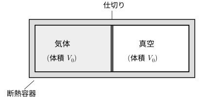
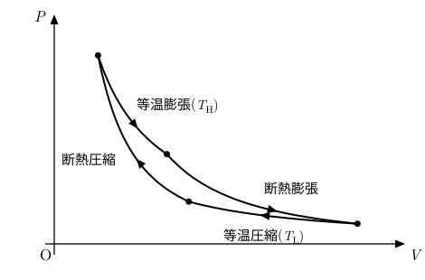
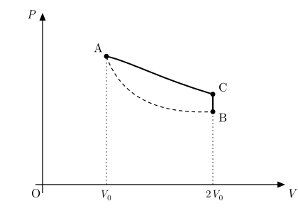

# 分子間に引力がはたらく気体(型C 熱 / 理想気体の手順を別の系でやり直す / 想定30分 / 標準〜やや難)

狙い: `analysis/trend.md` で直近の L2 が集中している型(2022 III ゴムひも、2025 III(2) $U = 3PV$ の気体)。
前半で理想気体の手順(第一法則の微小変化 → 断熱の式、等温での吸熱、自由膨張)を確認し、後半で状態方程式と内部エネルギーを差し替えて同じ手順をやり直させる。
「変わるもの(圧力、自由膨張での温度)」と「変わらないもの(断熱の式、等温での吸熱、熱効率)」を見分けさせるのが核。
コードブックの判定では L2(モデルの提示: 状態方程式と内部エネルギーの式)。名称(ファンデルワールス)は伏せた。

改訂(誘導量を本番に合わせた): 答えの数を 17 → 16 にし、第一法則の式(i)、内部エネルギーの各項の意味、手順の方針を本文で与えた。図を 1 → 4 枚に増やした。最後に、断熱膨張に置き換えたサイクルと比べさせる問3 を置いた。

## 問題

次の文章を読んで，[ ] に適した式または数値を，{ } からは適切なものを一つ選びその番号を，それぞれの解答欄に記入せよ。また，**問1**〜**問3**では，指示に従って，解答を解答欄に記入せよ。ただし，気体定数を $R$ とする。

以下では，物質量 $1\,\mathrm{mol}$ の気体の状態変化を考える。気体の圧力を $P$，体積を $V$，絶対温度を $T$，内部エネルギーを $U$ とする。**図1**のように，気体をなめらかに動くピストンのついたシリンダーに入れ，体積をゆっくりと変化させる。体積が $V$ から $V + \Delta V$ に，温度が $T$ から $T + \Delta T$ に微小変化するとき，気体が外部にする仕事は $P\Delta V$ と表されるので，この間に気体が吸収する熱量を $\Delta Q$，内部エネルギーの変化を $\Delta U$ とすると，熱力学第一法則は

$$\Delta Q = \Delta U + P\Delta V \qquad \cdots\cdots \text{(i)}$$

と書ける。微小な変化では，微小量どうしの積は無視してよい。また，必要であれば，次の(a)，(b)を用いてよい。

(a) $|\Delta V|$ が $V$ に比べて十分小さいとき，$\dfrac{1}{V + \Delta V} \fallingdotseq \dfrac{1}{V} - \dfrac{\Delta V}{V^2}$ が成り立つ。

(b) ある状態変化の間，微小な変化について $\dfrac{\Delta T}{T} = -c\,\dfrac{\Delta V}{V}$($c$ は定数)がつねに成り立つならば，その状態変化の間，$TV^{c}$ は一定に保たれる。

**(1)** まず，単原子分子理想気体の場合を考える。この気体では，状態方程式 $PV = RT$ が成り立ち，内部エネルギーは $U = \dfrac{3}{2}RT$ と表される。

気体をゆっくりと断熱変化させるとき，式(i)で $\Delta Q = 0$ とおき，$\Delta U = \dfrac{3}{2}R\Delta T$ と状態方程式を用いると，$\dfrac{\Delta T}{T} =$ [ あ ] $\times \dfrac{\Delta V}{V}$ が得られる。したがって，(b)より，この断熱変化の間，$TV^{c}$($c =$ [ い ])は一定に保たれる。

また，温度 $T$ を一定に保ったまま，体積を $V$ から $V + \Delta V$ までゆっくりと微小変化させるときには，内部エネルギーは変化しないので，式(i)より，気体が吸収する熱量は $\Delta Q =$ [ う ] である($R$, $T$, $V$, $\Delta V$ で表すこと)。

次に，ゆっくりではない変化の例として，**図2**のように，断熱容器を仕切りで体積 $V_0$ ずつの2つの部分に分け，一方に温度 $T_0$ の気体を入れ，他方を真空にした場合を考える。仕切りを取り除き，十分に時間がたつと，気体は容器全体に広がって一様になる。この過程では，気体は外部に仕事をせず，熱の出入りもないので，気体の内部エネルギーは変化しない。したがって，気体の温度は { え: ①上がる，②変わらない，③下がる }。

**(2)** 次に，理想気体とは異なる，ある気体 G を考える。$1\,\mathrm{mol}$ の気体 G の圧力と内部エネルギーは，正の定数 $a$ を用いて

$$P = \frac{RT}{V} - \frac{a}{V^2}, \qquad U = \frac{3}{2}RT - \frac{a}{V}$$

と表されるものとする。これは，分子どうしが互いに引力を及ぼしあう気体を表す一つのモデルである。内部エネルギーの第1項は分子の運動エネルギーの和，第2項は分子間の引力による位置エネルギーの和を表しており，体積が大きくなって分子どうしが離れるほど，位置エネルギーは大きくなる。以下では，つねに $RT > \dfrac{a}{V}$ が成り立つ範囲で考える。また，気体 G についても式(i)は成り立つ。(1)で行ったのと同じ手順を，気体 G について順に行ってみよう。

同じ温度，同じ体積で比べると，気体 G の圧力は単原子分子理想気体の圧力より { お: ①大きい，②小さい }。これは，壁に衝突しようとする分子が，内側にあるほかの分子から引力を受けるためと理解できる。

気体 G の体積を一定に保ったまま，温度を $\Delta T$ だけ上げるのに必要な熱量は [ か ] である。

**図2**の容器の一方に，温度 $T_0$ の気体 G を入れ，他方を真空にして，(1)と同じように仕切りを取り除いた。この場合も，気体 G の内部エネルギーは変化しない。このことから，十分に時間がたったあとの気体 G の温度は [ き ] と求められる($R$, $a$, $T_0$, $V_0$ で表すこと)。

次に，気体 G をシリンダーに入れ，ゆっくりと断熱変化させる場合を考える。体積が $V$ から $V + \Delta V$，温度が $T$ から $T + \Delta T$ に微小変化するとき，(a)を用いると，内部エネルギーの変化は $\Delta U = \dfrac{3}{2}R\,\Delta T\,+$ [ く ] $\times\,\Delta V$ と表される。これと気体 G の圧力の式を，式(i)で $\Delta Q = 0$ とおいたものに代入すると，$\dfrac{\Delta T}{T} =$ [ け ] $\times \dfrac{\Delta V}{V}$ が得られる。したがって，温度 $T_0$，体積 $V_0$ の状態から，体積が $2V_0$ になるまでゆっくりと断熱膨張させると，気体 G の温度は $T_0$ の [ こ ] 倍になる。

また，気体 G の温度 $T$ を一定に保ったまま，体積を $V$ から $V + \Delta V$ までゆっくりと微小変化させるとき，気体 G の内部エネルギーは変化することに注意すると，式(i)より，気体 G が吸収する熱量は $\Delta Q =$ [ さ ] である($R$, $a$, $T$, $V$, $\Delta V$ のうち必要なもので表すこと)。

**問1** **図3**は，単原子分子理想気体を，絶対温度 $T_{\mathrm{H}}$ の等温膨張，断熱膨張，絶対温度 $T_{\mathrm{L}}$($T_{\mathrm{L}} < T_{\mathrm{H}}$)の等温圧縮，断熱圧縮の順に，ゆっくりと変化させてもとの状態に戻すサイクルを表している。このサイクルでは，等温膨張で吸収する熱量 $Q_{\mathrm{H}}$ と，等温圧縮で放出する熱量 $Q_{\mathrm{L}}$ の間に，$\dfrac{Q_{\mathrm{L}}}{Q_{\mathrm{H}}} = \dfrac{T_{\mathrm{L}}}{T_{\mathrm{H}}}$ の関係が成り立つことが知られている。気体 G を用いて，同じ温度 $T_{\mathrm{H}}$，$T_{\mathrm{L}}$ の間で，同じ4種類の過程からなるサイクルを行うとき，その熱効率を $T_{\mathrm{H}}$，$T_{\mathrm{L}}$ を用いて表せ。また，そのように考えた理由を，[ け ] と [ さ ] の結果にもとづいて説明せよ。

**(3)** 最後に，気体 G を用いた次のサイクルを考える。**図4**は，このサイクルにおける圧力と体積の関係を表している。ただし，過程 A→B はゆっくりとした変化ではなく，途中の状態の圧力は定まらないので，破線で示してある。

過程 A→B: **図2**の容器で，温度 $T_0$，体積 $V_0$ の状態 A から，仕切りを取り除いて，体積 $2V_0$ の状態 B にする。

過程 B→C: 体積を $2V_0$ に保ったまま加熱し，温度 $T_0$ の状態 C にする。

過程 C→A: 温度を $T_0$ に保ったまま，ゆっくりと圧縮して状態 A に戻す。

過程 B→C で気体 G が吸収する熱量は [ し ] である($R$, $a$, $T_0$, $V_0$ のうち必要なもので表すこと)。また，過程 C→A で気体 G が放出する熱量を $Q$ とすると，$Q$ は [ し ] より { す: ①大きい，②小さい }。

**問2** [ す ] の答を選んだ理由を，1サイクルの間に気体 G が外部にした仕事の符号に着目して説明せよ。

**問3** 過程 A→B のかわりに，状態 A からゆっくりと断熱膨張させて体積 $2V_0$ の状態 B′ にし，そのあと体積を $2V_0$ に保ったまま加熱して状態 C にする場合を考える。過程 B′→C で気体 G が吸収する熱量を求めよ。また，それが [ し ] より大きいことを示せ。必要であれば，$2^{-\frac{2}{3}} = 0.63$ を用いてよい。導出過程も書くこと。

## 解答

| 空欄 | 答 |
|---|---|
| あ | $-\dfrac{2}{3}$ |
| い | $\dfrac{2}{3}$ |
| う | $\dfrac{RT}{V}\Delta V$ |
| え | ② |
| お | ② |
| か | $\dfrac{3}{2}R\,\Delta T$ |
| き | $T_0 - \dfrac{a}{3RV_0}$ |
| く | $\dfrac{a}{V^2}$ |
| け | $-\dfrac{2}{3}$ |
| こ | $2^{-\frac{2}{3}}$ $\left(= \dfrac{1}{\sqrt[3]{4}}\right)$ |
| さ | $\dfrac{RT}{V}\Delta V$ |
| し | $\dfrac{a}{2V_0}$ |
| す | ① |

**問1** 熱効率は $1 - \dfrac{T_{\mathrm{L}}}{T_{\mathrm{H}}}$。

理由: [ け ] より、気体 G の断熱変化でも理想気体と同じく $TV^{2/3}$ が一定なので、気体 G のサイクルと同じ温度・同じ体積をたどる理想気体のサイクルを考えることができる。また [ さ ] より、等温過程の各微小変化で吸収する熱量 $\dfrac{RT}{V}\Delta V$ も理想気体と同じ式である。したがって、$Q_{\mathrm{H}}$、$Q_{\mathrm{L}}$ はどちらもその理想気体のサイクルの場合と等しく、$\dfrac{Q_{\mathrm{L}}}{Q_{\mathrm{H}}} = \dfrac{T_{\mathrm{L}}}{T_{\mathrm{H}}}$ が成り立つ。1サイクルで内部エネルギーはもとに戻るから、気体がした仕事は $Q_{\mathrm{H}} - Q_{\mathrm{L}}$ で、熱効率は

$$\frac{Q_{\mathrm{H}} - Q_{\mathrm{L}}}{Q_{\mathrm{H}}} = 1 - \frac{T_{\mathrm{L}}}{T_{\mathrm{H}}}$$

**問2** 過程 A→B(真空への膨張)と過程 B→C(定積変化)では気体は仕事をしない。過程 C→A は圧縮で、圧力は正だから、気体は外部から仕事をされる。したがって、1サイクルの間に気体が外部にした仕事は負である。1サイクルで内部エネルギーはもとに戻るので、熱力学第一法則より、(吸収した熱量)$-$(放出した熱量)$=$(外部にした仕事)$< 0$。吸収するのは過程 B→C の [ し ] だけ、放出するのは過程 C→A の $Q$ だけだから、$Q$ は [ し ] より大きい。

**問3** [ こ ] より、状態 B′ の温度は $2^{-\frac{2}{3}}T_0$。体積一定で温度を $T_0$ まで上げるので、[ か ] より、吸収する熱量は

$$\frac{3}{2}R\left(T_0 - 2^{-\frac{2}{3}}T_0\right) = \frac{3}{2}\left(1 - 2^{-\frac{2}{3}}\right)RT_0$$

$2^{-\frac{2}{3}} = 0.63$ を用いると、これは $\dfrac{3}{2}\times 0.37\,RT_0 = 0.555\,RT_0$。条件 $RT > \dfrac{a}{V}$ を状態 A にあてはめると $RT_0 > \dfrac{a}{V_0}$ だから

$$0.555\,RT_0 > 0.555\,\frac{a}{V_0} > \frac{a}{2V_0}$$

よって、[ し ] より大きい。

## 解説(どこで設定が切り替わり、何を転用するか)

**(1) 理想気体での手順の確認。** 断熱の微小変化では、式(i) で $\Delta Q = 0$ とし、$\Delta U = \dfrac{3}{2}R\Delta T$、$P = \dfrac{RT}{V}$ を入れて

$$\frac{3}{2}R\,\Delta T = -\frac{RT}{V}\Delta V \quad\Longrightarrow\quad \frac{\Delta T}{T} = -\frac{2}{3}\,\frac{\Delta V}{V}$$

(b) より $TV^{2/3}$ が一定(ポアソンの式)。等温の微小変化では $\Delta U = 0$ なので、吸収する熱量は $P\Delta V = \dfrac{RT}{V}\Delta V$。真空への膨張は $\Delta U = 0$ で、理想気体の $U$ は $T$ だけで決まるから温度は変わらない。

**ここまでの「手順」(式(i) に $U$ と $P$ の式を入れる)を、(2) でそのまま使う。本文の「同じ手順を、気体 G について順に行ってみよう」が誘導。**

**(2) モデルの差し替え。** 圧力は $\dfrac{a}{V^2}$ だけ小さい。

定積では仕事がないので、熱量は $\Delta U = \dfrac{3}{2}R\Delta T$($V$ が一定なので $-\dfrac{a}{V}$ の項は変わらない)。

真空への膨張では $\Delta U = 0$。今度は $U$ が $V$ にもよるので

$$\frac{3}{2}RT_0 - \frac{a}{V_0} = \frac{3}{2}RT_1 - \frac{a}{2V_0} \quad\Longrightarrow\quad T_1 = T_0 - \frac{a}{3RV_0}$$

**温度が下がる。** 分子間の距離が広がると位置エネルギーが増え、そのぶん運動エネルギー(温度)が減る。

ゆっくりとした断熱変化では、(a) を使って

$$\Delta U = \frac{3}{2}R\,\Delta T - a\left(\frac{1}{V + \Delta V} - \frac{1}{V}\right) = \frac{3}{2}R\,\Delta T + \frac{a}{V^2}\Delta V$$

式(i) で $\Delta Q = 0$ として

$$\frac{3}{2}R\,\Delta T + \frac{a}{V^2}\Delta V + \left(\frac{RT}{V} - \frac{a}{V^2}\right)\Delta V = 0 \quad\Longrightarrow\quad \frac{3}{2}R\,\Delta T = -\frac{RT}{V}\Delta V$$

**$a$ の項が打ち消し合い、理想気体と同じ式になる。** よって $TV^{2/3}$ が一定で、$V_0 \to 2V_0$ で温度は $2^{-2/3}$ 倍。

等温の微小変化では、$\Delta U = \dfrac{a}{V^2}\Delta V$(0 ではない)。

$$\Delta Q = \frac{a}{V^2}\Delta V + \left(\frac{RT}{V} - \frac{a}{V^2}\right)\Delta V = \frac{RT}{V}\Delta V$$

ここでも $a$ の項が消える。**本文は「内部エネルギーは変化することに注意すると」と警告している。それでも「等温なら $\Delta U = 0$」と理想気体の結論を持ち込むと、$\dfrac{RT}{V}\Delta V - \dfrac{a}{V^2}\Delta V$ と誤る。持ち込んでよいのは手順であって、結論ではない。**

問1 は、[ け ] と [ さ ] が理想気体と同じ式になったことの意味を問う。等温と断熱だけでできたサイクルの熱効率は、作業物質が何であっても $1 - \dfrac{T_{\mathrm{L}}}{T_{\mathrm{H}}}$ になる(カルノーの定理)。その一例を自分の計算で確かめさせている。

**(3) ゆっくりでない過程を含むサイクル。** B の温度は [ き ]、定積で $T_0$ まで戻すので

$$\frac{3}{2}R\left(T_0 - T_1\right) = \frac{3}{2}R\cdot\frac{a}{3RV_0} = \frac{a}{2V_0}$$

問2 は、$Q$ を計算せずに大小を判断させる。真空への膨張は仕事を取り出せないまま体積を広げてしまうので、もとに戻すには外から仕事をして、そのぶん余計に熱を捨てることになる。

問3 は誘導なしで書かせる。ゆっくり断熱膨張させたほうが温度が大きく下がる(気体が仕事をするぶんだけ内部エネルギーが減る)ので、戻すのに要る熱量も大きい。不等式の最後で、問題の冒頭近くに置かれた条件 $RT > \dfrac{a}{V}$ を思い出せるかが勝負。

(参考: $Q$ そのものは、[ さ ] を足し合わせて $Q = RT_0\log_e 2 = 0.69\,RT_0$。問3 の $0.555\,RT_0$ より大きく、B′→C→A のサイクルでも気体がする仕事は負になる。断熱膨張でする仕事より、等温圧縮でされる仕事のほうが大きいからである。)

**検算。**

- $a \to 0$ で、き $\to T_0$、し $\to 0$。理想気体の結果に一致。
- 次元: $\dfrac{a}{V}$ はエネルギー、$\dfrac{a}{V^2}$ は圧力、$\dfrac{a}{RV_0}$ は温度。
- (3) の1サイクルで $\Delta U = 0$: A→B は $0$、B→C は $+\dfrac{a}{2V_0}$、C→A は等温で $-\dfrac{a}{V_0} + \dfrac{a}{2V_0} = -\dfrac{a}{2V_0}$。和は $0$。
- 問3 の数値: $2^{-2/3} = 0.62996\ldots$、$\dfrac{3}{2}(1 - 0.63) = 0.555 > 0.5$。

## 出典・検証

- 題材は自作。与えたモデルは、ファンデルワールスの状態方程式で分子の大きさの補正($b$)を省き、単原子分子($C_V = \dfrac{3}{2}R$)としたもの。内部エネルギーが $U = C_V T - \dfrac{a}{V}$($1\,\mathrm{mol}$)となること、真空への断熱自由膨張で必ず温度が下がることは、次で確認した。
  - テキサス大学 R. Fitzpatrick の熱物理講義ノート(ファンデルワールス気体): https://farside.ph.utexas.edu/teaching/sm1/Thermalhtml/node66.html
  - エディンバラ大学 熱力学演習(内部圧 $(\partial U/\partial V)_T = a/V^2$、自由膨張): https://www2.ph.ed.ac.uk/~gja/thermo/Tutorials/tut7.pdf
  - Wikipedia「Internal pressure」: https://en.wikipedia.org/wiki/Internal_pressure
- 状態方程式と内部エネルギーの式は熱力学的に両立している($(\partial U/\partial V)_T = T(\partial P/\partial T)_V - P = \dfrac{a}{V^2}$)。したがって問1 の結論(熱効率 $1 - T_{\mathrm{L}}/T_{\mathrm{H}}$)はカルノーの定理と矛盾しない。
- 先例との関係: 2022 III(ゴムひも: 状態方程式と $U$ を与える)、2025 III(2)($U = 3PV$ の気体のサイクル)、2025 III(1)(微小変化の差分からポアソンの式)と同じ型。分子間引力のある気体は 2010〜2026 の京大物理には出ていない。
- 検証: 上の「検算」のとおり、極限・次元・1サイクルの内部エネルギー収支を手計算で確認した。
- 未検証: 人間による試答はしていない。想定時間 30 分と難易度は見積もり。
